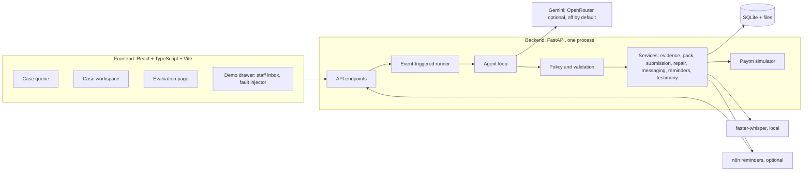
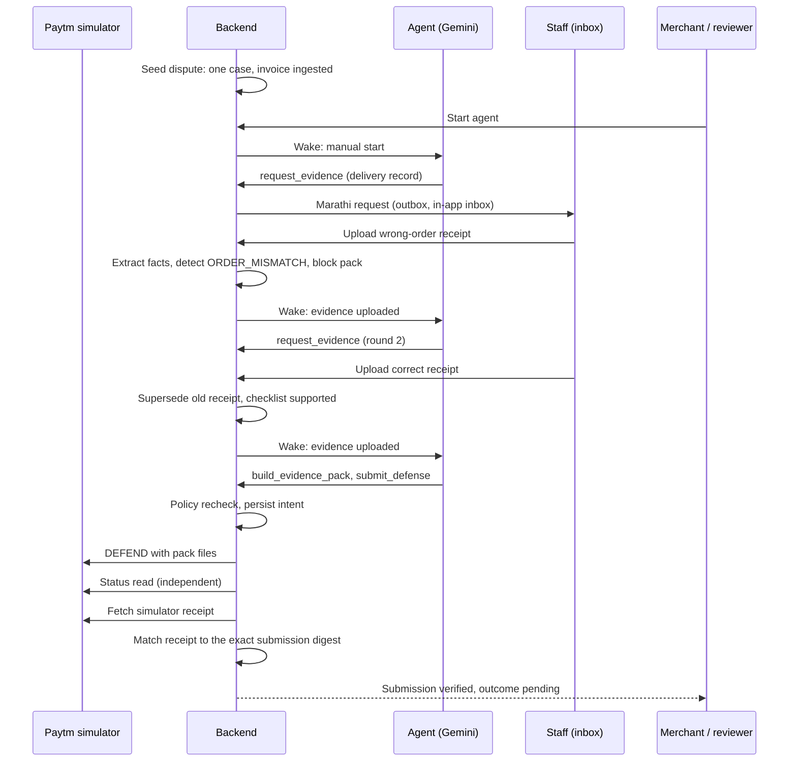

# ProofCircuit: Architecture

A locally hosted, synthetic-data prototype. Hosted inference (Gemini) is used for the live agent; everything else runs on the developer machine.

## 1. Design principles

1. **The model proposes, the backend authorizes.** All safety rules live in code.
2. **Persist before display.** The UI never shows an action that has no stored tool result.
3. **Verify independently.** A submission counts only after a separate status read and the simulator's receipt match the exact submission.
4. **Humans hold the dangerous powers.** Conceding is not an agent capability.
5. **Be honest about what is simulated.** Labels are always on screen.

## 2. System overview

## 3. Components

| Layer | Technology | Responsibility |
| --- | --- | --- |
| Frontend | React, TypeScript, Vite | Case queue, workspace, source preview, mismatch view, reviewer panel, evaluation page, demo drawer |
| API | Python, FastAPI, Pydantic | Typed endpoints and tool contracts |
| Runner | FastAPI BackgroundTasks, per-case locks | Event-triggered work, persisted pending work, one startup recovery scan; no polling worker |
| Agent | Gemini 3.x (live); OpenRouter adapter (optional) | Chooses the next action as structured JSON |
| Policy layer | Backend code | Deadline, ownership, permissions, contradictions, file limits, concede authority |
| Services | Backend code | Evidence parsing, checklist, pack building, submission and reconciliation, POD repair, messaging, reminders, voice testimony |
| Simulator | FastAPI routes in the same process, reached over its HTTP contract | Paytm-shaped Status and Action APIs, dispute lifecycle, independent receipts, fault injection |
| Database | SQLAlchemy, SQLite (WAL), Alembic migrations | Cases, evidence, facts, runs, messages, reviews, events; money as integer paise, UTC timestamps |
| Files | Local storage under `data/` | Original evidence bytes, packs, SHA-256 hashes |
| Speech | faster-whisper (local, optional) | Staff voice notes to transcripts |
| Reminders | n8n in Docker (optional) | Waits, then calls back for one reminder |

## 4. Repository layout

| Path | Contents |
| --- | --- |
| `backend/app/api/` | Endpoints |
| `backend/app/agent/` | Loop, tools, prompt, action schema |
| `backend/app/services/` | Evidence, validation, pack, policy, submission, repair, messaging, reminders, testimony |
| `backend/app/providers/` | Gemini, OpenRouter, speech, readiness |
| `backend/app/simulator/` | Paytm simulator |
| `backend/app/evaluation/` | Corpus generator, case seeding, HTTP harness |
| `backend/app/db/` | Models; migrations in `backend/alembic/` |
| `backend/tests/` | Offline tests |
| `frontend/src/` | Pages and components; E2E in `frontend/e2e/` |
| `fixtures/` | Hero documents, demo organisation, 40-case corpus and separate ground truth |
| `n8n/` | Workflow export, Docker Compose, setup and live-check scripts |
| `docs/` | Screenshots and evaluation exports |
| `scripts/` | Live authority check |

## 5. Data flow: hero case

## 6. Safety layers

| Layer | What it enforces |
| --- | --- |
| Tool surface | 9 tools; no concede, refund or arbitrary messaging |
| Schema validation | Model output must be one valid structured action |
| Policy checks | Deadline, pack currency, contradictions, open reviews, file limits, one request per round |
| Authority | Concede is reviewer-only, with a single-use confirmation that expires in 15 minutes |
| Refund guard | Dry run only; denied while a dispute is open |
| Untrusted content | Document text cannot instruct the agent; injection attempts are flagged |
| Budgets | 8 steps per run, 60-second call deadline, retry backoff, daily call cap |
| Verification | Status read plus an independent simulator receipt that matches the exact submission |

## 7. Failure handling

| Failure | Behaviour |
| --- | --- |
| Model unavailable or over budget | The run pauses; the app falls back to Manual (or labelled Fixture replay); escalate if needed |
| Provider timeout or lost response | Read status and receipts first, reconcile, never submit twice |
| Upload failure (`4010`) | Reconcile, then at most one resend of the same payload, then human review |
| Stale or unreadable status | Bounded re-reads; never mark verified; human review if still unreadable |
| POD rejected | One correction round, then a human |
| Backend restart | A single startup scan resumes pending work without duplicate effects |

## 8. Persistence and audit

- Every run stores the trigger, provider and model, action, validation result, tool result and timestamps.
- Evidence is never deleted; superseded items keep their reason.
- The UI audit timeline reads from these records.

## 9. Local run

| Service | Address |
| --- | --- |
| Frontend | http://127.0.0.1:5173 |
| Backend API | http://127.0.0.1:8000 |
| n8n (optional, needs Docker) | http://127.0.0.1:5678 |

Use the demo drawer's **Seed / reset** to start a fresh hero case. Re-run the live-agent smoke test before any demo; it lasts 24 hours.

## 10. Limits and non-goals

- Paytm and WhatsApp are not connected. No real money moves.
- Only goods-not-received disputes are supported.
- The 40-case result is on our own synthetic corpus, not on real disputes.
- Not built: Sarvam speech adapter, local Gemma fallback, Cognee.
