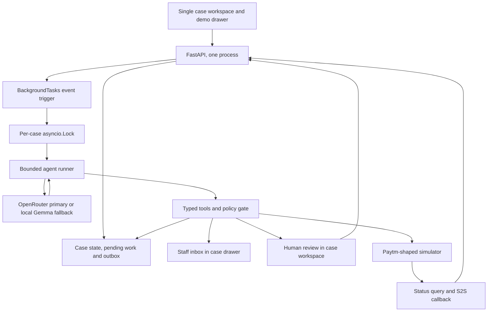

# ProofCircuit — Product Requirements and Build Specification

**Team:** MergeInfinity  
**Track:** Paytm Build for India AI Hackathon, Track 3: Autonomous AI Teammates  
**Version:** 1.4, explicit backend-to-n8n trigger contract; two pre-event build days plus event day
**Prepared:** 29 October 2026, Asia/Kolkata  
**Status:** Proposed MVP. No production integration, merchant pilot, or measured performance is claimed.

### Changes in 1.4

- Requires the backend to trigger n8n automatically after creating a staff evidence request; the reminder callback endpoint alone does not start a workflow.
- Specifies the trigger payload, separate authentication in each direction, persisted retry state, importable workflow deliverables and setup checks in Section 12.1.

### Changes in 1.3

- Reconciles a lost upload acknowledgement using independent simulator receipt/pack identity plus a separate status read; an acknowledgement is no longer a prerequisite that can deadlock recovery.
- Treats `4006 POD_ALREADY_UPLOADED` as evidence that documents exist, never proof of which pack was uploaded.
- Preserves the exact supplied deadline, including non-midnight values. End-of-day examples are fixtures, not a universal Paytm rule.
- Keeps one bounded POD correction round in P0. Local Gemma is an optional tested fallback; OpenRouter alone can satisfy the real-reasoning release gate.
- Distinguishes cited staff testimony from verified delivery documents, and defines audio/transcript provenance and confirmation.
- Defines an authenticated, idempotent n8n reminder command with reply/deadline/case cancellation checks.
- Labels the 240-character outgoing comments cap and unresolved lifecycle behavior as application/simulator policy, not verified production requirements.

### Changes in 1.2

- **Status API success code corrected** to `1001 / S / SUCCESS`. `1003 / AUDIT_SUCCESS` was a placeholder from the page's generic attribute description and is removed.
- **Complete result-code tables** for both APIs, adding `4001`–`4004`, `4006 POD_ALREADY_UPLOADED`, `4010 POD_UPLOAD_FAILED` and `4011 DISPUTE_ACCEPTANCE_NOT_ALLOWED` (Section 11.2).
- **Dispute status lifecycle defined** for the simulator: `NEW`, `POD_UPLOAD`, `POD_REJECT`, `WON`, `LOST` (Section 11.2.3). Resubmission is allowed only from `POD_REJECT`.
- **Verification rule tightened** around `4006`, status reads after timeouts, and what real Paytm can and cannot prove (Section 8.6).
- **`comments` is now a short human-readable remark** (≤240 characters, verified facts only), not a hash/locator string (Section 11.2.4).
- **Contract details added:** `version` is not a Status request field, `tokenType` casing differs between pages, `requestTimestamp` may be seconds or milliseconds, optional fields arrive as `null`, `disputeType` is not a cardholder reason code, some due-date samples end at `23:59:59` (not a general rule), and no file-type list is published.
- **Build plan changed** to two pre-event days plus the event day. Sarvam speech-to-text and self-hosted n8n reminders move up to P0+ (Sections 3.2 and 17).

### Build-first summary

1. **Hero flow:** dispute arrives → invoice present, delivery proof missing → Marathi request to delivery staff → wrong receipt detected and blocked → correct receipt → pack built → `DEFEND` to simulator → status read shows `POD_UPLOAD` → "Submission verified — outcome pending".
2. **Simulator:** exactly the Section 11.2 contracts, code tables and lifecycle.
3. **Safety:** the LLM proposes, the backend authorizes; only a human can concede; no refund while a dispute is open; no write after the due date.
4. **Honesty:** synthetic data, simulator and model mode always labelled; unmeasured results never claimed.

## 1. Instructions for the coding agent

Build a working application from this document, starting with the P0 vertical slice. The product is **ProofCircuit**, not Saakshi. Prior presentation diagrams communicate the concept; this PRD takes precedence where implementation details differ.

1. Inspect the repository and any `AGENTS.md` before changing code. Preserve existing conventions if a repository already exists.
2. Implement one complete case journey before adding optional services. Do not build only a dashboard, chatbot, or animated workflow.
3. Every successful action displayed in the UI must have a persisted tool result. Never fabricate a submission, citation, conversation response, test result, or bank decision.
4. Use OpenRouter free-first as the primary reasoner and the existing local Gemma as a tested fallback, as specified in Section 6. Do not purchase credits, enable billing, deploy publicly, send real messages, or call financial production endpoints.
5. Put provider-specific code behind the interfaces in Section 12. Missing credentials must disable an integration cleanly, not block the whole application.
6. Implement and run the eight core contract test groups in Section 15. Preserve the 40-case evaluation target from the presentation; execute a ten-case first pass before the full run, and report actual coverage. Keep deterministic tests independent of live model availability. Test the real model separately.
7. Create `README.md`, `.env.example`, lockfiles, sample evidence, seed/reset commands, tests, and `BUILD_LOG.md` as implementation deliverables. Record actual commands and unresolved issues in `BUILD_LOG.md`.
8. Pin versions that install and pass checks together. Never guess that a dependency, SDK method, model quota, or provider entitlement exists.
9. A cached/fixture replay is a fallback demonstration mode, not proof of autonomous reasoning. Label it throughout the UI and evaluation output.
10. Stop adding scope when the three main demonstrations work: missing evidence, contradictory evidence, and safe verified submission.

This is a **locally hosted, synthetic-data hackathon prototype**, with hosted inference through OpenRouter by default. Real money movement and production Paytm actions are explicitly outside the release.

## 2. Product definition

ProofCircuit is an AI teammate that owns the work of preparing a merchant's payment-dispute response. It opens a case, finds missing proof, requests it from the appropriate staff member, checks consistency, builds a source-linked evidence pack, submits it through a simulator, and independently verifies the submission status.

The first supported dispute reason is **goods not received**, for an online SMB selling physical goods. The output is a defensible, traceable response and a verified submission receipt. It is not a guaranteed dispute win.

### 2.1 Problem overview

Evidence for one order can be distributed across a billing invoice, a delivery receipt, and conversations with staff. The operational task is to collect the correct records, identify inconsistencies, meet a response deadline, and track the response after submission. A chatbot that explains the process leaves this work with the merchant.

Paytm documents dispute notifications, evidence submission and status APIs, response deadlines, restrictions on refunds during open disputes, and potential settlement deductions for lost disputes. Use those documents as the integration reference, not as evidence that this prototype has live access. [R1–R4]

### 2.2 What must be real versus simulated

| Component | Required behavior in this build |
| --- | --- |
| AI interpretation and next-action selection | Real inference with the configured OpenRouter model or tested local Gemma fallback. Log the provider/model used. |
| Evidence parsing and comparison | Run on actual uploaded bytes/text. Persist extracted values and citations. |
| Messages and follow-ups | Real application state and event processing inside a merchant/staff chat simulator. No real WhatsApp delivery. |
| Human review | Real reviewer action recorded by the backend, not an agent-created approval. |
| Paytm action/status/webhook | Explicitly simulated, with persisted independent provider state and controllable failures. |
| Submission verification | Query the simulator's provider state; do not merely trust the submission tool's response. |
| Dispute outcome | Pending unless a reviewer explicitly injects a simulated provider outcome. Never infer a win from an upload. |

### 2.3 Users

- **Merchant owner:** sees the dispute, evidence checklist, next action, submission status, and outstanding human tasks.
- **Merchant staff:** responds to evidence requests and uploads the correct invoice or delivery record in the simulated staff inbox.
- **Human reviewer:** examines contradictions and explicitly authorizes conceding a dispute when appropriate.
- **Demo operator/judge:** loads scenarios, injects simulator failures, and observes evidence-backed actions.

The merchant and staff are simulated users in one local application. Do not build an external CRM or a customer-contact system in P0.

## 3. Scope and priorities

### 3.1 P0: required working release

| ID | Requirement | Completion evidence |
| --- | --- | --- |
| FR-01 | Ingest and normalize a synthetic Paytm-shaped callback and create exactly one case. | Duplicate-event test and a persisted case. |
| FR-02 | Attach and parse TXT, JSON and text-based PDF evidence. | Evidence viewer, extraction records, original-byte hashes. |
| FR-03 | Build a case-specific checklist and detect missing records. | Checklist distinguishes missing, supported, conflicting and review-required items. |
| FR-04 | Select and execute bounded tools using a real reasoning provider. | An observable tool loop that adapts to newly received evidence. |
| FR-05 | Request missing proof from the appropriate staff member. | An outbox record and a request visible in that staff inbox. |
| FR-06 | Handle English, Hindi and Marathi text. | Unicode input/output, locale-specific request templates and fixtures. |
| FR-07 | Detect hard contradictions and prevent unsafe submission. | Wrong-order and conflicting-date scenarios stop before submission. |
| FR-08 | Build a source-linked response pack. | Downloadable manifest, evidence index and submission files. |
| FR-09 | Enforce permissions, deadline, ownership and upload constraints. | Backend policy tests; UI cannot bypass them. |
| FR-10 | Submit through a fault-capable Paytm simulator, then verify separately. | Matching receipt/pack hash from the status query. |
| FR-11 | Persist pending work, runs, messages, reviews and events across restart. | Single startup recovery scan/manual resume without duplicate effects. |
| FR-12 | Show an audit timeline and export evaluation results. | Real event timestamps and machine-readable results. |

P0 must work without Sarvam, n8n Cloud, Cognee Cloud, WhatsApp credentials, an OpenAI key, a paid database, or a Paytm merchant account. Real autonomous reasoning requires either a working OpenRouter account/key with eligible capacity or an optionally configured local Gemma passing its smoke test. Without either, the app still opens in manual/replay mode with an honest label. No OpenRouter entitlement is assumed from event registration.

### 3.2 P0+: build on pre-event Day 2 (Section 17)

The team has two pre-event build days, so these move up from P1. P0 must still run without them.

- **Sarvam speech-to-text for one staff voice note** (the product's main differentiator), using the team's own signup credit. `faster-whisper` is the fallback.
- **Self-hosted n8n Community** for staff follow-up reminders, calling the same backend command APIs.
- Ten-case benchmark run with real counts.

### 3.3 P1: add after P0 and P0+ pass

- Image OCR for English/Hindi/Marathi evidence, including source bounding boxes.
- Optional direct Gemini/OpenAI adapters, only with verified account access and budget/terms.
- Browser text-to-speech or Sarvam Bulbul when an appropriate voice exists.
- Cognee evidence-retrieval adapter with local providers.
- PostgreSQL configuration and local Docker Compose profile.

### 3.4 Deferred

Real WhatsApp messages, live Paytm writes, production financial transactions, billing, merchant onboarding/KYC, settlement recovery, all dispute categories, autonomous acceptance of customer disputes, bank/network outcome prediction, re-challenges, and complex or repeated automatic proof repair.

P0 includes one bounded correction round for a recognized POD rejection before the deadline (Section 8.6). Unknown reasons, repeated rejection, insufficient time or unchanged evidence require human review. This does not promise an autonomous dispute win.

## 4. Hackathon resources: verified, uncertain, and what to do now

**Checked 29 October 2026. Public information is not an account entitlement.**

The matching HackBriven Mumbai announcement identifies an eight-hour event on **3 October 2026** and names Sarvam, n8n and Cognee as collaborators. That date is already past at the time of this document. It does not establish the date, rules, or tool allocation of a different/upcoming edition. [R5]

A partner promotional post describes **$20,000 in platform credits for the best AI usage team**, across n8n, Cognee and Sarvam. That is described as an award to a selected team, not a guaranteed development budget for every registrant. It also mentions developer access without specifying a per-participant allocation. Treat it as a promotional claim, not a build-time entitlement. [R6]

| Resource/question | Publicly established | Planning decision now | Replace/enable later only when |
| --- | --- | --- | --- |
| Sarvam at event | Named collaborator; universal event credit allocation not verified. | Text-first P0; Sarvam Saaras adapter on pre-event Day 2 using the team's own signup credit (P0+). | A usable key, balance, supported models and conditions are visible in the team's account. |
| Sarvam general signup offer | Official docs advertise ₹100 credits for verified signup. This is separate from event sponsorship. [R7] | Optional convenience; core flow must not depend on eligibility or remaining balance. | Account verification and a small successful test are complete. |
| n8n | Named collaborator; cloud access/credits per participant not verified. | Python workflow runner; optional self-hosted Community edition. [R10] | Cloud access is confirmed, or local self-hosting is chosen and configured. |
| Cognee | Named collaborator; hosted quota per participant not verified. | SQL-backed case context and retrieval. | A local/provider-backed Cognee configuration passes the adapter tests. [R11] |
| OpenRouter | No event-provided key or allowance verified. This is our chosen gateway, not a confirmed event benefit. | User-created key, eligible free model/capacity and explicit privacy settings; existing local Gemma fallback. | A compatible model passes the smoke test; paid usage additionally requires explicit budget. |
| GPT-4.1/direct OpenAI | No guaranteed key or allowance verified for this edition. | Optional later adapter; not a P0 dependency. | Explicit account access and acceptable budget are supplied. |
| Paytm dispute APIs | Public docs exist; access is not implied by registering. | Simulator only. | Organizer/Paytm confirms dispute-product access, merchant/test credentials and allowed testing. |
| WhatsApp Business API | No event-provided account, approved sender or messaging credit verified. | Local merchant/staff chat simulator. | Authorized sender/test account, current terms and delivery setup are provided. |
| GPU, hosted database, deployment credits | No guaranteed allocation verified. | Existing laptop, SQLite, local files; discover and test the already-installed Gemma tag before the demo. | Actual equipment or hosting access is confirmed. |
| Mandatory sponsor-tool use | Collaboration names do not prove a mandatory technical rule. | Build adapters; do not force sponsor infrastructure into P0. | The actual rules/rubric require it. |
| Existing/pre-event code permitted? | Not established by the available posts. | Build the reusable app; record authorship and dependency provenance. | Check the current participant rules before claiming submission eligibility. |

Before an event, the team should inspect the registration email/participant kit for credit redemption, mandatory tools, prebuilt-code rules, deployment requirements, and credential access. Do not block implementation while waiting. No organizer has been contacted as part of this PRD.

## 5. Core experience and demonstration

### 5.1 Hero case

Use fictional merchant **Metro Furniture Demo**, order `ORD-DEMO-18500`, dispute `DSP-DEMO-001`, amount **1,850,000 paise (INR 18,500)**. Seed the response deadline relative to the seed clock, initially 48 hours ahead; never hard-code a date that expires when the app is demonstrated later.

1. A Paytm-shaped simulator callback opens the seeded goods-not-received dispute. The header shows **Amount at risk: ₹18,500.00** beside the deadline countdown. Do not label it a settlement hold without an explicit provider signal; show reported debit and `disputeUtr` only when supplied.
2. An invoice is present; delivery proof is missing. The agent creates a delivery-proof task and sends a Marathi request to the assigned delivery staff inbox.
3. The staff member uploads a receipt referencing `ORD-DEMO-OTHER`. The system detects the mismatch, cites the conflicting sources and blocks submission.
4. The agent asks for the correct receipt. A staff member uploads it. The old receipt remains in the audit trail and is marked excluded/superseded with a reason; it is not silently deleted.
5. The agent validates the corrected pack, submits through the simulator if policy allows, and then queries status independently.
6. The UI shows **Submission verified — dispute outcome pending**, with receipt ID, submission timestamp and evidence-pack hash.
7. Optional extension: inject a recognized POD rejection while time remains. Show its exact reason in the staff drawer, receive corrected proof, build a new pack and reverify one resubmission. A second rejection escalates rather than looping.

The staff upload is a human step in the demo, not a fabricated agent response. An optional pre-recorded staff-reply event is allowed only in explicitly labeled replay mode.

### 5.2 Secondary demonstrations

- **POD repair:** one recognized pre-deadline rejection requests corrected proof; a duplicate event does not create another request, and a repeat rejection escalates.
- **Refund conflict:** a dry-run refund request while the dispute is active returns `DENY_OPEN_DISPUTE`; no refund provider is called.
- **Expired deadline:** an expired case cannot submit, even if the LLM proposes submission.
- **Ambiguous provider timeout:** simulator accepts the pack but loses the HTTP response. The app reconciles status before retrying and produces only one submission.
- **Human concession:** reviewer explicitly chooses “Accept the customer's dispute (concede)”. This is a separate action from submitting evidence or approving an upload.

## 6. Chosen stack and free replacements

### 6.1 Default implementation

| Layer | Build now | Later replacement | Notes |
| --- | --- | --- | --- |
| Frontend | React + TypeScript + Vite; ordinary CSS or existing repository styling. | Keep. | White background, charcoal text, teal accents, readable evidence tables. [R16] |
| API | Python 3.11+ and FastAPI; Pydantic request/response models. | Keep. | Typed domain and tool contracts; OpenAPI docs. [R15] |
| Persistence | SQLAlchemy with SQLite in WAL mode. | PostgreSQL through `DATABASE_URL`. | Use integer paise, explicit UTC timestamps and migrations. [R17] |
| Reasoning | OpenRouter primary; configured installed Gemma/Ollama fallback; validated JSON actions on both. | Change compatible model ID; optional direct provider adapters later. | Free capacity requires an account/key and quota; test the exact local tag. [R8, R9, R22–R26] |
| Workflow | FastAPI BackgroundTasks, per-case locks, persisted pending/outbox state and one startup scan. | Durable queue/n8n adapter if deployment requires it. | One Uvicorn process; no continuous DB polling or lease worker. [R27] |
| Evidence context | SQL facts/citations, filtered retrieval within a case; optional SQLite full-text index. | Cognee. | No embeddings or paid graph service required. |
| Text extraction | `pypdf` for text-based PDFs; text/JSON parsers. | OCR/vision adapter. | Scanned PDFs are not automatically readable by pypdf. [R14] |
| Pack rendering | ReportLab for a neutral English cover PDF; escaped HTML and JSON for the evidence index/manifest. | A richer report renderer if needed. | Preserve original evidence; do not redraw it as though it were an authentic source document. |
| Speech recognition | Disabled in P0; P0+ Sarvam Saaras for one voice note; `faster-whisper` multilingual `small`, CPU `int8` as fallback. | Keep both behind `SpeechProvider`. | Download before event; benchmark Hindi/Marathi, do not promise accuracy. [R12] |
| Speech output | Text always; optional browser `speechSynthesis`. | Sarvam Bulbul. | Installed Hindi/Marathi voices vary by device. [R13] |
| Images/OCR | P0 rejects as `OCR_REQUIRED` or accepts explicitly labeled manual transcription. P1 Tesseract with `eng`, `hin`, `mar` models. | Funded vision/OCR provider. | Preserve original image and source coordinates when OCR is added. [R18] |
| Messaging | Local in-app staff inbox/outbox. | WhatsApp provider. | Never display “Delivered on WhatsApp” for local messages. |
| Financial interface | Local Paytm-like simulator. | Separately authorized Paytm adapter. | Live adapter remains unimplemented/disabled in this release. |
| Files | Local `data/evidence` and `data/packs`; server-generated paths. | Object storage. | No public bucket required. |
| Tests | pytest for domain/API; frontend test runner and Playwright for the main journey. | Keep. | Eight core test groups; 40-case synthetic evaluation target with ten-case first pass. Keep contract tests network-free. |

“Free” means no mandatory paid API/subscription. The existing computer, bandwidth, storage, electricity and any chosen hosting still have costs. Do not promise free cloud infrastructure.

### 6.2 OpenRouter primary, existing local Gemma fallback

**Decision:** use OpenRouter as the primary inference gateway. Local Gemma is an **optional fallback**, not a P0 release dependency. Reuse the user's already installed Gemma 4B if time permits, after discovering its exact model tag with `ollama list` and checking `/api/show`. “Gemma 4B” alone does not identify the generation or installed tag. Do not pull Qwen or replace the installed model automatically.

OpenRouter is a gateway, not one model. Configure the model ID, inspect current model/endpoint capabilities, and run a small schema/action smoke test. It does not make every routed model tool-capable. P0 uses **validated JSON action proposals** on both providers; native `tool_calls` are optional P1, not a second mandatory agent implementation. [R22–R25]

Provider selection:

1. Use the configured OpenRouter model when the key, capability check and quota are ready. `openrouter/free` is a useful zero-priced bootstrap/discovery choice; it selects available free models and may change models between calls. Prefer a specific tested, eligible model ID for the final demo and record the model actually returned. [R26]
2. If explicitly configured and enabled, fall back to local Gemma only when its JSON-action contract smoke test passes. Log the switch, reason, provider and model. Local Gemma does not need native function calling for the JSON-action path.
3. If both fail, pause with `Reasoner unavailable`; offer manual operation or explicitly labeled fixture replay. Do not mark replay as an autonomous model run.

**Free-first policy:** OpenRouter requires an account/key and eligible free capacity or an existing funded balance. No hackathon allowance is assumed. Keep `ALLOW_PAID_MODELS=false` by default; allow only the free router or a catalog-verified zero-priced model for all billed request components. Do not automatically switch to a paid variant, top up, or enable billing. A paid model may be configured only after the user explicitly supplies budget/access.

Preflight should inspect `GET /api/v1/models` and, when available to the key, `GET /api/v1/key`. Use `provider.require_parameters=true` with the requested structured-output parameters; reject unsupported endpoints rather than silently losing schema enforcement. Apply Pydantic validation even when the endpoint advertises strict output. Configure privacy/provider restrictions deliberately; default to `data_collection: "deny"`, and never silently relax it to obtain a free endpoint. The app uses synthetic data only. [R22–R25]

Free limits/capacity vary. Ten cases at eight reasoning calls each already require **80 requests before extraction, repairs or retries**; this is a planning example, not a quota promise. Persist request/usage counts, honor rate-limit hints and stop when the configured call/budget cap is reached. Run deterministic contract tests with a fake Reasoner. Run only a small live-model smoke test initially, then the ten-case first pass and full 40-case evaluation if capacity allows; mark any unrun cases honestly. [R24]

Local profile: default to `options.num_ctx=8192` and `temperature=0.0`, with an output budget and bounded context assembled from verified excerpts rather than the full chat history. More context consumes memory and does not cure bad evidence selection. If supported by the exact installed model, set `think=false`; omit unsupported thinking controls. For a separately chosen Qwen3 model, explicitly send `think:false`. Do not claim a 3–5× speed-up without measurements. Preserve required policy/citations when compacting context. [R8, R21]

Example local request shape (replace the model tag after discovery; insert the actual generated action schema):

```json
{
  "model": "gemma3:4b",
  "stream": false,
  "options": {"num_ctx": 8192, "temperature": 0.0},
  "format": "json",
  "messages": [
    {"role": "system", "content": "Return only one action matching the supplied action schema."},
    {"role": "user", "content": "Synthetic case context and action schema go here."}
  ]
}
```

The example uses Ollama JSON mode for readability. The implementation should pass the full `ProposedAction` JSON Schema to `format`, as in R8, when the installed model/runtime supports it. All outputs still undergo backend validation. A user with a different Gemma tag must use that installed tag.

Gemini/direct OpenAI remain optional later adapters, not additional P0 work. Existing local compute, bandwidth and any account-funded inference have costs; “free-first” does not mean unlimited hosted inference.

### 6.3 Changes from the pitch stack

The slides proposed GPT-4.1, Sarvam, n8n, Cognee and PostgreSQL. Their responsibilities remain in the architecture, but P0 substitutes OpenRouter with an optional tested local Gemma fallback, text-first input, an event-triggered Python runner, SQL retrieval and SQLite. These are explicit implementation choices, not claims that sponsor tools have been integrated. Update the demo/deck labels to reflect the provider actually running.

## 7. Architecture and ownership



P0 uses event-triggered FastAPI `BackgroundTasks`, one in-memory `asyncio.Lock` per case and a **single startup recovery scan**. There is no continuously polling job worker, lease scheduler, Redis or Celery. This is a deliberate single-process demo architecture, not a durable distributed queue. [R27]

- The LLM proposes; the backend authorizes and executes. Database state and independent simulator records remain authoritative.
- In one short database transaction, apply the incoming event and mark the case/outbox as pending. Commit **before** scheduling the background task and returning the HTTP response.
- The background callable obtains that case's shared lock, opens its own DB session, re-reads the latest version, and processes pending events until the case is waiting/complete or its run budget is reached.
- Inbound events during a run persist a continuation flag/event. Before releasing the lock, the runner rechecks pending work so a message received during processing is not lost. Duplicate scheduled tasks become no-ops after re-reading state.
- Keep DB transactions short. Do not hold them across model calls, file parsing or simulated network waits. A per-case lock alone does not serialize writes from different cases: use a small process-wide DB-write lock/serialization helper if needed, SQLite busy timeout and bounded lock retries. WAL does not permit unlimited concurrent writers.
- Use asynchronous HTTP for inference; move blocking local parsing/CPU work off the event loop. BackgroundTasks does not make CPU-bound code asynchronous.
- At startup, scan persisted interrupted runs, pending outbox messages and uncertain submissions once. Resume/reconcile them before any repeat write. A periodic polling worker is not necessary.
- Expose a “Resume pending work” action in the demo drawer. Do not rely on browser refresh alone for recovery.
- Use exactly **one Uvicorn worker**, one instance and no reload during the judged demo. In-memory locks do not coordinate multiple processes; multiple workers require a later durable queue/DB-lock design.
- Waiting for staff/review returns control without repeated model polling. New evidence, a reviewer decision or a callback triggers continuation.

## 8. Functional requirements by module

### 8.1 Case intake

Accept the Paytm Chargeback Peon-style `head`/`body` callback in Section 11, verify the demo signature, resolve `body.mid` to a known merchant and normalize the external contract into internal snake_case fields. Persist the original body, canonical payload hash, received timestamp, signature result and raw provider status. The sample in the public page uses **`transactionId`**, not `txnId`; use that spelling. Optional aliases must be explicit, tested adapter rules rather than guessed field renames. [R4]

External money is a decimal string. Parse with `Decimal`; reject negative/non-finite values and more than two fractional digits rather than silently round. Preserve `transactionAmount`, `disputeAmount` and `debitAmount` separately; derive internal disputed `amount_paise` from `disputeAmount`, not automatically the full transaction amount. Example: `"18500.00" → 1850000`. The dispute integration is configured as INR; the callback itself does not establish a generic multi-currency contract.

The callback shows naive `YYYY-MM-DD HH:mm:ss` dates. Configure `PAYTM_NAIVE_TIMEZONE=Asia/Kolkata` **as the simulator's explicit assumption** and convert to aware UTC; the inspected page does not explicitly establish that every real payload uses IST. Preserve the raw string and assumption, reject malformed/ambiguous formats, and confirm the live integration timezone before activation. Display time in Asia/Kolkata. [R3, R4]

Required internal fields: case ID, merchant/MID mapping, external dispute/transaction/order IDs, separate amounts, configured currency, normalized reason, deadline UTC, locale, assignees, workflow/provider states and case version. Do not infer “goods not received” from a vague `disputeType` alone: the seeded demo maps its known synthetic event to that reason; an unknown external type requires review.

The public sample does not supply a generic `event_id`/sequence. Simulator-only transport headers may carry `X-Demo-Event-Id` and `X-Demo-Sequence`; keep them outside the Paytm body and label them as our harness metadata. Without a provider event ID, deduplicate/reconcile using canonical payload identity and current case/submission state. Never claim Paytm provides those demo headers.

### 8.2 Evidence collection

Each checklist item records its requirement, status, source IDs, assignee and explanation. For the demo's goods-not-received policy, require:

1. A transaction/order linkage for the disputed order.
2. An invoice identifying that order and amount/currency, or an explicitly documented amount reconciliation.
3. A delivery record linking the order to a delivery event and date.

This checklist is **our demo policy**, not a universal list of evidence guaranteed to satisfy a bank. Customer acknowledgements are optional supporting evidence and can introduce contradictions.

Deduplicate evidence requests by case, requirement and request round. Track `queued`, `sent_in_simulator`, `responded` and `failed`; a local outbox insert is not an external delivery receipt. Let the merchant reply or upload via the staff simulator. Use configured staff roles, not model-invented phone numbers.

Provide an English/Hindi/Marathi locale selector. P0 uses approved request templates for predictable essential messages, with optional model drafting. Example templates:

- Hindi: `इस ऑर्डर की डिलीवरी रसीद उपलब्ध नहीं है। कृपया सही रसीद भेजें।`
- Marathi: `या ऑर्डरची डिलिव्हरी पावती उपलब्ध नाही. कृपया योग्य पावती पाठवा.`

Treat these as demo starter copy; obtain language review before real customer use. Never claim unrestricted multilingual ability from two templates.

### 8.3 Extraction, provenance and validation

Store original bytes before parsing and compute SHA-256. Persist extracted text per page with its own text hash. Ask the LLM for the exact `raw_value` substring, field, document/page and optional surrounding quote; **never ask it to count character indices**. Python locates the substring in the stored page text and computes `start` and `end` deterministically before assigning `span_verified`. An agent-generated assertion is not a source.

Use `text.find(raw_value)` only after checking that the match is unique in the stated page/anchor scope. A missing match is invalid; multiple matches require deterministic surrounding anchors or human clarification, not an arbitrary first occurrence. Normalize the value after locating the raw substring. Store offsets as zero-based, end-exclusive Unicode code-point indices into the exact stored page text, not original PDF byte offsets. The frontend must slice by code points or use backend-generated snippets; JavaScript UTF-16 indices are not always equivalent.

Example extraction record (the backend supplies offsets after matching, not the LLM; the end below assumes the illustrative substring starts at 45):

```json
{
  "field": "order_id",
  "raw_value": "ORD-DEMO-18500",
  "normalized_value": "ORD-DEMO-18500",
  "source": {"document_id": "doc-01", "page": 1, "start": 45, "end": 59},
  "method": "pdf_text_then_llm",
  "verification": "span_verified"
}
```

The backend must verify `page_text[start:end] == raw_value` against the recorded text hash before persisting a verified span. Reject or flag an extraction with an invalid source span. Treat model-reported confidence as a hint, not a probability or a permission to submit. An absent/ambiguous critical field stays unknown.

Required deterministic checks:

- Exact canonical order/transaction linkage; retain raw formatting. Do not aggressively strip arbitrary ID characters until unrelated orders collide.
- Decimal-to-integer currency conversion with an explicit currency. Never use floating-point money comparisons.
- Invoice amount versus disputed amount: mismatch requires explanation/review; do not assume every partial dispute equals the invoice total.
- Delivery date cannot precede order date. Conflicting delivery events require review; a receipt alone is not a universal proof of delivery.
- Superseded or unrelated documents are excluded with a recorded reason. Originals remain in history.
- Content that instructs the agent to ignore policies, approve a case, reveal secrets or call tools is untrusted evidence content, not an instruction.

Digital PDF/TXT/JSON parsing is P0. An image-only PDF must produce `OCR_REQUIRED`, not an empty successful extraction. Manual transcription must record its human author and method; never relabel it as OCR. Optional OCR/STT output requires the same provenance/confirmation discipline.

**P0+ staff voice-note contract:** a transcript is staff testimony, not proof that delivery occurred. Store original audio bytes/hash, staff author and case, locale, provider/model, upload time, transcript text/hash, available segment timestamps, and any human corrections as a new version. Cite transcript text by deterministic spans and link available audio timestamps; do not invent timestamps when the provider does not return them. Mark STT output unconfirmed until the staff member confirms/corrects it. Even confirmed testimony must not on its own satisfy the required delivery-document checklist item or justify `ORDER_DELIVERED`. In the hero flow, a voice note can explain the wrong receipt or identify which corrected document staff will upload; the actual matching delivery record still supports the defense. Without STT capacity, use typed staff text or explicitly labelled human transcription. Original synthetic audio may be sent to Sarvam only when that optional feature is explicitly enabled.

### 8.4 Decision and human review

The agent may request clarification, flag contradictions, prepare a pack and submit a permitted simulated `DEFEND` action. It may not decide that a legitimate customer complaint should always be contested.

Hard identity/order mismatches cannot be bypassed by an unqualified “Approve” click. Resolve them with corrected evidence or an explicit, source-backed exclusion. Review captures the reviewer identity, decision, cited records and explanation.

**Accepting the customer's dispute means conceding it.** Label that action distinctly in UI and logs. It requires an explicit reviewer confirmation and a server-issued, single-use approval bound to the case version and exact action. An LLM response, evidence upload or staff message cannot create approval.

### 8.5 Controlled submission

Create an immutable pack version with ordered document hashes and source-linked claims. Include a cover PDF for the simulator, using neutral English summaries and source references, plus the original supporting files. Keep Unicode source text in the JSON manifest/evidence viewer; test font shaping before rendering Indic text in exported PDFs.

For `DEFEND`, `build_evidence_pack` must derive the mandatory `orderStatus` from verified shipping facts, persist its citations and generate a short human-readable `comments` remark from verified facts (Section 11.2.4); hashes and source locators stay in the manifest. Delivered-event proof maps to `ORDER_DELIVERED`; a dispatch/AWB record maps to `ORDER_IN_TRANSIT` but does not satisfy this P0 delivery-proof policy on its own. Missing or ambiguous state blocks automatic submission. See Section 11.2 for exact provider mapping. Repaired evidence always creates a new immutable pack.

Artifact outputs:

- `manifest.json`: pack version, hashes, claims and source references.
- `evidence-index.html`: readable source-linked case summary.
- `cover.pdf` and selected original supporting files for the simulated upload.

Count the cover PDF among uploaded files. The manifest/index are downloadable audit artifacts, not automatically extra upload attachments. Paytm's documented Action API limits include **at most five files and 5 MB per file**. The simulator defaults to a conservative 5,000,000-byte ceiling. Paytm publishes no allowed-file-type list: the simulator allowlist (PDF, JPEG, PNG) is our assumption. Both must be confirmed before activation. [R2]

Validate current deadline, case version, ownership, unresolved critical flags, required evidence, attachment count/size/type, provider status and approval requirements immediately before the write. A previously computed green checklist is insufficient after the case changes.

For P0, clean `DEFEND` submissions may run automatically **only against the simulator** when `AUTO_SUBMIT_SIMULATOR=true`. Concession always needs reviewer approval. All live financial/provider writes stay disabled.

### 8.6 Verification, rejection repair and follow-up

Keep action requested, provider acknowledged, independently verified submission and dispute outcome as separate concepts. A Status API `resultInfo` of `1001 / S / SUCCESS` means only that the lookup succeeded; the case state is in `disputeStatus`. `POD_UPLOAD` shows proof was received, not that it was accepted or that the dispute was won.

**Simulator verification rule:** require (a) a successful, separate Status read showing normalized `POD_UPLOAD`, and (b) an independently persisted simulator receipt matching the trusted MID/dispute, `DEFEND` action and **the exact current pack hash/submission intent**. An Action acknowledgement (`1001/UPLOADED_SUCCESS`, with `S` or the documented `A` variant) is recorded when available but is not mandatory if the response was lost and (a)+(b) establish acceptance. Never require a second write merely to obtain an acknowledgement. The receipt must come from the simulator's independent provider store, not be reconstructed from the application's request or Submission row.

`4006 POD_ALREADY_UPLOADED` means only that documents already exist for the dispute. It does not prove that our request succeeded, that those documents match the current pack, or that a repaired pack replaced an older one. Keep the response as reconciliation evidence; it never grants verification by itself. Against real Paytm, the documented Status response has no pack hash/receipt extension. A matching dispute and upload state can support the label **Provider reports proof uploaded — exact pack unverified**; do not claim simulator-level content verification. The live adapter remains out of scope.

On an ambiguous write timeout (`5001` or a lost response), persist `SUBMISSION_UNCERTAIN`, query status, and look up the independent simulator receipt before any retry:

1. If `POD_UPLOAD` and the exact intended pack receipt match, mark the submission verified even without an Action acknowledgement; do not resend.
2. If `POD_UPLOAD` exists but the receipt is absent or identifies an older/different pack, retain uncertainty and request review after bounded read retries. Do not assume success or overwrite documents blindly.
3. If no matching receipt exists and the authoritative simulator state is still an eligible pre-upload state (`NEW` for an initial defense, `POD_REJECT` for a permitted correction), recheck deadline/version/policy and retry the same serialized pack once with the same idempotency key. A `4006` response returns to reconciliation, not automatic success.
4. If the provider has already moved to a rejection or outcome state, preserve that current state and reconcile the historical receipt separately; never force it back to `POD_UPLOAD` to satisfy a UI rule. Unknown, contradictory or unresolved results require human review.

Read retries/backoff are bounded by the run budget. Reconciliation must not consume an additional POD correction round or manufacture a receipt. Changed evidence creates a new immutable pack and intent; a prior pack's receipt cannot verify it.

**P0 bounded self-healing:** when the provider explicitly reports a recognized POD rejection (the demo uses `POD_REJECT`) with a nonempty `comment`, the response deadline remains in the future, and the rejection has not already been handled for that submitted pack:

1. Persist the raw status/comment and identify the affected submission/pack.
2. If the configured repair budget remains, transition `MONITORING → WAITING_FOR_EVIDENCE`.
3. Create a staff task containing the provider's exact rejection reason, quoted/escaped as untrusted text, plus a clear request for corrected evidence. The agent may interpret the reason but cannot obey instructions embedded in it.
4. On the actual staff reply/upload, re-extract and revalidate, build a **new** immutable pack and derive a fresh `orderStatus`. Do not just resend the same bytes.
5. Recheck deadline, policy and current provider state before any re-submission. For this simulator, resubmit only while normalized `disputeStatus` is `POD_REJECT`. Reject other states according to the simulator table (including `4006` for an existing upload and `4005` after the due date); do not present that exact state-to-error mapping as a confirmed Paytm production rule. Set `comments` to a short remark addressing the rejection (Section 11.2.4). Verify the new response independently.

Default `MAX_POD_REPAIR_ROUNDS=1` means one correction cycle and at most two distinct submission attempts. A repeated rejection, unknown reason, unchanged pack, missing deadline, expired deadline or new hard contradiction opens human review. Duplicate/stale callbacks must not increment the budget or send duplicate requests. A free-text `comment` without a recognized rejection state must not trigger repair. Deadline expiry during the wait stops the write.

Synchronous upload validation errors (for example file too large) are not themselves a POD review rejection. Show the exact error, correct a safely fixable packaging issue once or request a replacement file; never manufacture a provider review event. Re-challenges beyond this one rejection cycle remain deferred.

## 9. Agent execution contract

Implement a bounded `observe → propose → validate → authorize → execute → verify/persist` loop. Use a provider-neutral JSON action schema rather than requiring every model to implement the same native tool-calling format.

```json
{
  "action": "request_evidence",
  "arguments": {"requirement_id": "delivery_record", "assignee_id": "staff-delivery", "locale": "mr-IN"},
  "reason": "The invoice is present, but no delivery record is attached.",
  "source_ids": ["doc-invoice-01"]
}
```

The tool dispatcher supplies the case and merchant from trusted run context. The model cannot switch tenant/case through arguments. `source_ids` must belong to the current case.

| Tool | Purpose | Permission |
| --- | --- | --- |
| `get_case_context` | Read current case version, facts, checklist, policy and messages. | Read-only, scoped. |
| `inspect_evidence` | Read a selected document/extraction and source spans. | Read-only, scoped. |
| `request_evidence` | Create one staff task and one simulated message. | Allowed simulated action; deduplicated. |
| `validate_evidence` | Run deterministic checks and persist findings. | Backend determines results. |
| `request_human_review` | Open a review task with evidence-linked questions. | Allowed, deduplicated. |
| `build_evidence_pack` | Create an immutable pack, derive/cite `orderStatus` and build a template-based, fact-checked `comments` remark (max 240 chars). | Requires relevant evidence and no unresolved blocking contradiction. |
| `submit_defense` | Submit a specific pack version to the simulator. | Recheck policy; simulator only. |
| `get_submission_status` | Read independent provider state. | Read-only; may verify submission. |
| `wait_for_event` | Suspend until evidence, review or provider event arrives. | No repeated model polling. |

The agent tool list **does not contain** `accept_dispute`, `issue_refund`, arbitrary HTTP, shell execution, database SQL, or unrestricted messaging. Concession is a dedicated reviewer API action. The refund demonstration calls a policy-check endpoint only.

Start with a maximum of eight proposals per run, two schema-repair attempts per model response, a configurable per-call timeout, and a total run timeout. After limits, persist `AGENT_LIMIT_REACHED` and create a human task. Do not loop until the model agrees.

Use a compact prompt: product role, case summary, verified facts/citations, missing requirements, allowed actions and relevant policy. Explicitly delimit documents as untrusted data. Do not log or expose private model reasoning traces. Display short action rationales, tool inputs/results and citations instead.

For OpenRouter, use `/api/v1/chat/completions`, the selected compatible model ID, `temperature: 0`, and `response_format: {"type": "json_schema", "json_schema": {"name": "proposed_action", "strict": true, "schema": <generated ProposedAction schema>}}`. Set `provider: {"require_parameters": true, "data_collection": "deny"}`. This is a request sketch: substitute the generated schema, not a literal placeholder. Generate that schema from the same Pydantic contract used for validation; avoid separate handwritten variants. Unsupported model/endpoints pause or fall back according to the configured policy. Native tool support is not required for this JSON-action protocol. [R22, R23]

For Ollama, use local `/api/chat` with the same schema in `format`, `options: {"num_ctx": 8192, "temperature": 0.0}`, and `think: false` only if the installed model supports that control. Validate with the same Pydantic type. Do not confuse local Ollama with its hosted cloud service. [R8, R21]

Retry/fallback occurs only at the inference boundary. After any tool executed, re-read persisted state and reconcile uncertain submissions before proposing another action. Switching models must not replay an entire already-executed run or bypass write idempotency.

## 10. State, storage and concurrency

### 10.1 Separate workflow state from provider outcome

Workflow states:

`NEW`, `COLLECTING`, `WAITING_FOR_EVIDENCE`, `NEEDS_HUMAN_REVIEW`, `READY_TO_SUBMIT`, `SUBMITTING`, `SUBMISSION_UNCERTAIN`, `MONITORING`, `CLOSED`.

Operational error flags such as `DEADLINE_EXPIRED`, `PROVIDER_UNAVAILABLE`, `OCR_REQUIRED`, and `PROVIDER_REJECTED` are recorded separately. Provider statuses retain both the raw string and a normalized category. Do not use a single status enum to conflate workflow, financial outcome and tool availability.

| Event/condition | Required transition |
| --- | --- |
| Valid new event | `NEW → COLLECTING`; queue the first run. |
| Missing required proof | `COLLECTING → WAITING_FOR_EVIDENCE`; create task/message. |
| New evidence/message | Resume `COLLECTING` with a new case version. |
| Blocking contradiction | `NEEDS_HUMAN_REVIEW`; no submission. |
| Required evidence passes checks | `READY_TO_SUBMIT`. |
| Policy-authorized simulator write | `SUBMITTING`. |
| Timeout with unknown provider effect | `SUBMISSION_UNCERTAIN`; reconcile. |
| Independent verification succeeds | `MONITORING`; outcome remains pending. |
| Recognized POD rejection, future deadline and unused repair budget | `MONITORING → WAITING_FOR_EVIDENCE`; preserve reason, request correction, require a new pack before resubmission. |
| Repeated/unknown rejection, expired deadline or unexpected reopening | Human review with raw event preserved. |

### 10.2 Minimal entities

| Entity | Important fields |
| --- | --- |
| `Merchant`, `DemoUser` | ID, merchant scope, role, locale. |
| `Case` | Internal IDs plus MID mapping, disputed/transaction/reported-debit amounts, optional UTR, deadline UTC, states, roles, `version`, latest pack and POD repair count. |
| `EvidenceDocument` | Case/merchant, original filename, storage key, MIME, size, SHA-256, extraction status, superseded/exclusion reason. |
| `ExtractedFact` | Field, raw/normalized value, source locator, extraction method, confirmation state. |
| `ChecklistItem`, `ValidationFinding` | Requirement/rule ID, severity, source IDs, status and explanation. |
| `StaffTask`, `Message` | Assignee, locale, requirement, direction, delivery state and deduplication key. |
| `Review`, `Approval` | Human actor, decision, action/payload hash, case version, expiry and consumed timestamp. |
| `EvidencePack`, `Submission` | Version, ordered hashes, request/idempotency key, provider reference, verification state. |
| `AgentRun`, `ToolCall` | Provider/model, mode, short rationale, inputs/results, timing, errors. |
| `PendingWork`, `OutboxEvent` | Case/event version, pending/running/completed status, attempts, payload and completion marker; no polling lease scheduler. |
| `ProviderEvent`, `AuditEvent` | Raw/sanitized payload, canonical dedup key, optional simulator event ID/sequence, signature result, applied version and timestamp. |
| `SimulatorSubmission` | Independent simulated provider receipt, accepted pack hash, status and sequence. |

Use UUIDs internally. Monetary fields are integer paise. An append-only audit table is enough for the demo; do not call it tamper-proof. Hashes identify content; they do not prove the document is authentic.

### 10.3 Idempotency, event triggers and recovery

- Deduplicate by provider event ID where genuinely supplied. Our simulator supplies optional transport-level event IDs/sequences, not invented Paytm body fields.
- Without such an ID, retain the canonical body hash and reconcile against current provider/case state. Record a handled-rejection marker per submitted pack so repeat delivery cannot start a second repair.
- Request key: `(case_id, requirement_id, request_round)`. Submission key: `(merchant_id, dispute_id, action, pack_hash)`.
- Use the shared per-case in-memory lock plus optimistic version checks immediately before writes. Keep persisted `pending_work`, run state and outbox state; do not implement job leases in P0.
- Reuse the serialized payload/idempotency key for a retry of the same pack. Changed evidence or a legitimate correction round creates a new pack/key and invalidates stale approvals.
- A timeout-after-accept must resolve to the existing independent simulator receipt. Provider-model fallback only repeats **inference**; it never retries a tool write automatically.
- A startup recovery pass reconciles interrupted submissions before repeat writes and resumes pending cases/outbox messages. Completed messages and consumed approvals are not executed again.
- Out-of-order or unknown provider states trigger an authoritative status check. Do not rank statuses monotonically: a rejected pack is a valid regression from monitoring into evidence collection.
- Multiple processes/instances, distributed leases and production-grade durable scheduling are P1. Time-based staff reminders come from the optional self-hosted n8n instance (P0+) calling backend APIs; the backend never polls. The judged demo requires one backend process and explicit event/resume triggers.

## 11. App and simulator API

Keep application/domain APIs separate from the **Paytm-shaped provider boundary**. Internal names such as `merchant_id` and integer paise are appropriate inside the app; external Paytm adapters use the documented names and representations. No production hosts are called.

| Method/path | Behavior |
| --- | --- |
| `GET /api/health`, `GET /api/providers` | Readiness, exact provider/model and fallback/capability status; no secrets. |
| `POST /api/demo/session` | Server-issued scoped demo role/merchant session. |
| `POST /api/demo/seed`, `POST /api/demo/reset` | Demo fixture lifecycle; reset requires operator action. |
| `POST /api/dispute-events` | Paytm Chargeback Peon-style S2S callback; normalize external fields after verification. |
| `GET /api/cases`, `GET /api/cases/{id}` | Scoped case queue/detail. |
| `POST /api/cases/{id}/evidence` | Evidence upload and deterministic provenance extraction. |
| `GET /api/evidence/{id}/content` | Scoped original-byte preview. |
| `POST /api/cases/{id}/messages` | Staff drawer reply; persist then schedule continuation. |
| `POST /api/cases/{id}/reminders` | Optional authenticated n8n command; backend rechecks the unresolved staff task and applies Section 12.1 deduplication/cancellation policy. |
| `POST /api/cases/{id}/runs` | Event-triggered start/resume; return run ID. |
| `GET /api/cases/{id}/events?after={cursor}` | Persisted UI event deltas; SSE optional. |
| `POST /api/cases/{id}/reviews`, `POST /api/cases/{id}/accept-dispute` | Reviewer decision and separately authorized concession. |
| `POST /api/cases/{id}/refund-policy-check` | Dry-run permission check, never a refund write. |
| `GET /api/cases/{id}/pack` | Versioned manifest/index/downloads. |
| `POST /api/simulator/v1/dispute/status` | JSON Paytm-style status request and response. |
| `POST /api/simulator/v1/dispute/action` | Multipart form fields/files for `DEFEND` or `ACCEPT`; JSON response envelope. |
| `GET /api/simulator/receipts/{reference}` | **Our simulator-only** independent pack/receipt verification; not a claimed Paytm endpoint. |
| `POST /api/simulator/events` | Drawer fault/POD-rejection/outcome injection. |
| `POST /api/demo/resume-pending` | Explicit recovery trigger; no continuous worker. |
| `GET /api/evaluation/results` | Actual metrics, denominators, model and run mode. |

Application validation errors use HTTP `422`; scoped access uses `403`/scoped `404`; stale case/approval uses `409`. Simulator business responses also expose Paytm-style `body.resultInfo`. Always inspect the body: HTTP success alone is not business success.

### 11.1 Paytm-shaped intake and normalization

Example **synthetic** Chargeback Peon callback, following the names in R4. R4 describes this webhook as fired when a dispute is created; R1 adds that the dispute webhook also reports each later status change (`POD_UPLOAD`, `POD_REJECT`, `WON`, `LOST`) and the settlement UTR for lost disputes. The body carries no event ID or sequence number. Paytm signs it with its CHECKSUM scheme; the algorithm is documented separately on the Checksum page and is not reproduced here.

```json
{
  "head": {"version": "v1", "signature": "DEMO_SIGNATURE"},
  "body": {
    "transactionId": "TXN-DEMO-001",
    "orderId": "ORD-DEMO-18500",
    "disputeAmount": "18500.00",
    "disputeDueDate": "2030-01-03 23:59:59",
    "bankReferenceNo": "BANK-DEMO-001",
    "disputeType": "Successful Order, Service/product delivered",
    "message": "Chargeback dispute has been filed",
    "extSerialNo": "EXT-DEMO-001",
    "mid": "MID-DEMO-001",
    "merchantName": "Metro Furniture Demo",
    "custId": "CUST-DEMO-001",
    "transactionDateTime": "2030-01-01 15:30:00",
    "transactionAmount": "18500.00",
    "disputeId": "DSP-DEMO-001",
    "disputeStatus": "NEW"
  }
}
```

At the configured Asia/Kolkata demo assumption, the deadline becomes `2030-01-03T18:29:59Z` and the dispute amount becomes `1850000` paise. Test both transformations. Seed relative dates in the real fixture generator; the literal dates above only illustrate the contract.

Optional `comment`, `disputeLostReason`, `debitAmount`, and loss/settlement reference belong to the applicable provider state. The S2S table spells the last field `disputeutr`, while the Status API uses `disputeUtr`; preserve raw payloads and map these two documented spellings explicitly. Missing debit/UTR means unknown/not reported, not proof of a hold or debit. Reject conflicting alias values.

Our demo signature is HMAC-SHA256 with a separate development secret and is clearly identified as such. Matching field names does **not** make that cryptography Paytm CHECKSUM-compatible. A future live adapter requires current Paytm checksum implementation and staged verification. Do not present `DEMO_SIGNATURE` as a real valid signature.

### 11.2 Status and action contracts

Aligned with the public Paytm pages checked on 29 October 2026 (R2, R3); conflicting examples and simulator policies below are not a verified production contract. Production endpoints are `POST https://secure.paytmpayments.com/v1/dispute/status` and `POST https://secure.paytmpayments.com/v1/dispute/action`; staging uses `securestage.paytmpayments.com` with the same paths. The simulator mirrors these paths under `/api/simulator/v1/dispute/...`. No Paytm host is called in this release.

#### 11.2.1 Dispute Status API (JSON in, JSON out)

Documented request head fields: `requestTimestamp` (mandatory), `clientId` (optional), `tokenType` (optional; the Status page writes the value as `Checksum`, the Action page as `CHECKSUM` — accept both case-insensitively) and `signature` (mandatory; Paytm computes it over the JSON-stringified `body`). `version` is **not** a documented request field; the simulator ignores it if sent. Body: `mid`, `disputeId`.

Example local simulator request:

```json
{
  "head": {
    "requestTimestamp": "1893492000",
    "clientId": "C11",
    "tokenType": "CHECKSUM",
    "signature": "DEMO_SIGNATURE"
  },
  "body": {"mid": "MID-DEMO-001", "disputeId": "DSP-DEMO-001"}
}
```

Example status lookup result. `resultInfo` describes **the lookup**; `disputeStatus` separately describes **the case**. The documented success code for this endpoint is `1001 / S / SUCCESS`. (The page's generic `resultInfo` attribute description uses `1003 / AUDIT_SUCCESS` as a placeholder example; that value does not appear in the Status response table or sample and must not be used.)

```json
{
  "head": {
    "responseTimestamp": "1893492001",
    "version": "v1",
    "clientId": "C11",
    "signature": "DEMO_SIGNATURE"
  },
  "body": {
    "resultInfo": {
      "resultStatus": "S",
      "resultCodeId": "1001",
      "resultCode": "SUCCESS",
      "resultMsg": "Success"
    },
    "mid": "MID-DEMO-001",
    "disputeId": "DSP-DEMO-001",
    "transactionId": "TXN-DEMO-001",
    "transactionDateTime": "2030-01-01 15:30:00",
    "orderId": "ORD-DEMO-18500",
    "custId": "CUST-DEMO-001",
    "bankReferenceNo": "BANK-DEMO-001",
    "extSerialNo": "EXT-DEMO-001",
    "transactionAmount": "18500.00",
    "disputeAmount": "18500.00",
    "debitAmount": null,
    "disputeStatus": "NEW",
    "disputeType": "Successful Order, Service/product delivered",
    "disputeDueDate": "2030-01-03 23:59:59",
    "disputeLostReason": null,
    "comment": null,
    "disputeCreateDateTime": "2030-01-02 10:00:00",
    "disputeUpdateDateTime": "2030-01-02 10:00:00"
  }
}
```

Field notes from R3:

- Optional fields are returned as explicit `null` in Paytm's own sample (`debitAmount`, `disputeLostReason`). Treat `null`, missing and empty string all as "not reported".
- `disputeAmount` can be much smaller than `transactionAmount` (Paytm's sample shows `2.00` against `1200.00`). Always derive `amount_paise` from `disputeAmount`.
- `comment` is documented as `string(246)`: the POD-rejection remark. `disputeUtr` (camelCase here; `disputeutr` in the webhook) is the deduction reference for a lost dispute.
- `disputeType` documented values are broad merchant-side categories (`Successful Order`, `Service/product delivered`, combined in the sample). **Paytm does not send a cardholder reason code such as "goods not received".** The seeded demo maps its own synthetic event to the goods-not-received policy; a real deployment would need the merchant or reviewer to confirm the reason.
- Some Paytm samples use `23:59:59`, while the S2S attribute example uses `12:39:00`. Preserve the exact supplied date and time; never round or extend a deadline to end of day. Include both midnight-adjacent and non-midnight fixtures, and deny writes at/after the normalized instant. The hero seed remains relative to the seed clock (48 hours); no universal midnight rule is implied. [R4]
- New timestamps `disputeCreateDateTime` and `disputeUpdateDateTime` are useful for ordering out-of-sequence events; store them raw and normalized.

Status API result codes (R3):

| resultCodeId | resultStatus | resultCode | Simulator behaviour |
| --- | --- | --- | --- |
| `1001` | `S` | `SUCCESS` | Lookup succeeded; read `disputeStatus` for the case state. |
| `4001` | `F` | `INVALID_SIGNATURE` | Signature check failed. |
| `4002` | `F` | `MANDATORY_PARAM_MISSING` | Missing `disputeId`/`mid`. |
| `4003` | `F` | `REQUEST_PARAMS_INVALID` | Malformed request. |
| `4004` | `F` | `DISPUTE_ID_NOT_FOUND` | Unknown dispute for this MID. |
| `5001` | `U` | `SYSTEM_ERROR` | Retry the read with backoff; never treat as a case state. |

#### 11.2.2 Dispute Action API (multipart in, JSON out)

The page's attribute table says "API Content Type: JSON", but its use-case text and cURL sample use `multipart/form-data` because files are streamed. Implement **multipart**. Form fields (R2):

| Field | Required | Notes |
| --- | --- | --- |
| `mid` | mandatory | string(32). |
| `disputeId` | mandatory | string(64). |
| `action` | mandatory | `ACCEPT` or `DEFEND`. |
| `requestTimestamp` | mandatory | Epoch string(16). The docs show seconds in requests (`1588402269`) and milliseconds in response heads (`1526969112101`); the simulator accepts both and records which it received. |
| `signature` | mandatory | Computed over the request parameters by Paytm's checksum library. Demo uses HMAC (Section 11.1). |
| `orderStatus` | mandatory for `DEFEND` | `ORDER_DELIVERED` or `ORDER_IN_TRANSIT`. |
| `files` | conditional for `DEFEND` | Repeated multipart file parts. Max 5 files, max 5 MB each. |
| `filesPath` | conditional for `DEFEND` | SFTP-relative path; deferred. If both are sent, Paytm uses `files`. |
| `comments` | optional, `DEFEND` only | Documented as "Comment/Remark in case of POD Rejected" — a human-readable remark read by Paytm's operations reviewers. See 11.2.4. |
| `clientId`, `tokenType` | optional | `tokenType` value `CHECKSUM`. |

Paytm does **not** publish an allowed file-type list. The simulator allowlist (`application/pdf`, `image/jpeg`, `image/png`) is **our assumption** and must be labelled as such; confirm with Paytm before activation.

Action API result codes (R2 response table, complete):

| resultCodeId | resultStatus | resultCode | Meaning / simulator behaviour |
| --- | --- | --- | --- |
| `1001` | `S` (table) / `A` (sample) | `UPLOADED_SUCCESS` | Files uploaded; dispute moves to `POD_UPLOAD`. Verify separately. |
| `1002` | `A` | `ACCEPTED_SUCCESS` | SFTP upload request accepted asynchronously; deferred. |
| `1003` | `S` | `DISPUTE_ACCEPTED` | Merchant conceded; dispute moves to `LOST` and a debit follows. Human-only action. |
| `4001` | `F` | `INVALID_SIGNATURE` | Reject; no state change. |
| `4002` | `F` | `MANDATORY_PARAM_MISSING` | E.g. missing `disputeId` or missing `orderStatus` on `DEFEND`. |
| `4003` | `F` | `REQUEST_PARAMS_INVALID` | E.g. invalid `filesPath` or unknown `action`. |
| `4004` | `F` | `DISPUTE_ID_NOT_FOUND` | Unknown dispute for this MID. |
| `4005` | `F` | `POD_UPLOAD_NOT_ALLOWED` | Upload due date has expired. |
| `4006` | `F` | `POD_ALREADY_UPLOADED` | Documents already uploaded. **Simulator policy:** return for a second `DEFEND` in `POD_UPLOAD`, `WON` or `LOST` when no more specific validation error applies; production state/error precedence is unconfirmed. This does not identify the uploaded pack. |
| `4007` | `F` | `MAX_FILES_EXCEEDED` | More than 5 files. |
| `4008` | `F` | `MAX_SIZE_EXCEEDED` | A file exceeds 5 MB (simulator ceiling 5,000,000 bytes; exact boundary unconfirmed). |
| `4009` | `F` | `FILE_NOT_SUPPORTED` | Outside the assumed simulator allowlist. |
| `4010` | `F` | `POD_UPLOAD_FAILED` | Provider-side upload failure; no state change; safe to retry after a status check. |
| `4011` | `F` | `DISPUTE_ACCEPTANCE_NOT_ALLOWED` | `ACCEPT` after the due date. |
| `5001` | `U` | `SYSTEM_ERROR` | Effect unknown. Move to `SUBMISSION_UNCERTAIN` and reconcile before any retry. |

Documented inconsistency: the file-upload sample returns `"resultStatus": "A"` with `1001`, while the table lists `S`; the response sample head also uses `requestTimestamp` where the attribute table says `responseTimestamp`. The simulator emits the table form by default and has fixtures for the sample variants. The adapter accepts `1001/UPLOADED_SUCCESS` with either documented `S` or `A` as an upload acknowledgement, preserving the raw variant; inconsistent failure/unknown tuples require reconciliation; **neither sets "Submission verified"** on its own.

`4006` is a reconciliation signal: some documents already exist, but the code does not prove who uploaded them, when, or which bytes they contain. Query status first and follow Section 8.6. In the simulator, verify the exact current pack through the independent receipt; in a future live adapter, retain the weaker content-unverified label unless a separately validated mechanism establishes pack identity. Do not use a duplicate write as the normal verification strategy.

#### 11.2.3 Dispute status lifecycle

Paytm does not publish a formal `disputeStatus` enum. Values observed across R1, R3 and R4: `NEW`, `POD_UPLOAD` (R1 text also says "POD UPLOADED"), `POD_REJECT`, `WON`, `LOST`, and `Accept` (an example value). Freeze this simulator set and mark the spellings and exact state-to-error transitions as **unconfirmed for production**. The simulator emits one canonical form; the adapter tests explicitly documented aliases (for example `POD UPLOADED` to internal `POD_UPLOAD`) while preserving raw strings. Do not guess additional aliases or treat `Accept` as an upload/win without confirmed semantics:

| From | Trigger | To | Notes |
| --- | --- | --- | --- |
| — | Dispute raised | `NEW` | Webhook fired. |
| `NEW` | `DEFEND` with valid files before due date | `POD_UPLOAD` | Action returns `1001`. |
| `NEW` | `ACCEPT` before due date | `LOST` | Action returns `1003`; debit and `disputeUtr` follow on settlement. |
| `NEW` | Due date passes with no action | `LOST` | `disputeLostReason: "Failed to respond"`. |
| `POD_UPLOAD` | Paytm ops find proof insufficient | `POD_REJECT` | `comment` carries the reason. |
| `POD_REJECT` | New `DEFEND` before due date | `POD_UPLOAD` | Only state from which a second upload is accepted. |
| `POD_REJECT` | Due date passes | `LOST` | |
| `POD_UPLOAD` | Ops accept proof and forward to bank | `WON` | No debit. R1 says a won dispute can be re-challenged up to two more times; re-challenges are deferred. |
| `POD_REJECT` | `ACCEPT` before due date | `LOST` | Human-only concession after rejection. |

Every `LOST` invites a debit equal to the disputed amount on the merchant's next settlement (R1). Show `debitAmount`/`disputeUtr` only when reported.

The adapter stores the raw string and maps unknown values to `UNKNOWN`, which triggers an authoritative status read and human review. Do not rank statuses monotonically: `POD_UPLOAD → POD_REJECT` is a valid regression.

#### 11.2.4 Building the `DEFEND` request

`build_evidence_pack` must derive and cite `orderStatus`:

- Verified delivered-event record/receipt → `ORDER_DELIVERED`.
- Verified dispatch/AWB evidence without a delivered event → `ORDER_IN_TRANSIT`.
- Missing/ambiguous shipping state → no invented enum; request evidence or human review.

An AWB proves dispatch, not receipt by the customer. For this goods-not-received P0 policy, an in-transit record alone does not satisfy delivery proof or permit autonomous defense; keep collecting or escalate. The provider enum supports it, but evidence sufficiency is a separate decision.

**`comments` is read by a person, not a machine.** Generate a short plain-English rebuttal from verified facts only, for example: `Order ORD-DEMO-18500 delivered on 02-Jan-2030 to the registered address; signed delivery receipt is file 2, invoice is file 1.` Rules:

- Use only facts with `span_verified` citations; never model-invented claims.
- Reference evidence by its position in the uploaded `files` list.
- On a resubmission after `POD_REJECT`, state what changed in response to Paytm's `comment` (e.g. `Adds signed delivery receipt requested in rejection.`).
- **Application policy:** cap outgoing `comments` at 240 Unicode code points for concise remarks. This is not a confirmed Paytm limit. The incoming Status `comment` is a different field documented as `string(246)` and does not establish the outgoing Action field's limit, which remains undocumented. Keep full verified details in the evidence index/manifest.
- No pack hashes, character offsets or private document text. Hashes and citations stay in `manifest.json`.

Template-first: the comment is assembled from a deterministic template plus verified values; optional model rephrasing must pass the same length and fact-reference checks.

### 11.3 Failure controls and receipt verification

Support normal operation, timeout before/after acceptance, delayed status, file error codes, one POD-rejection correction cycle, duplicate/out-of-order events, invalid signatures and unknown statuses. The drawer injects these through the backend.

The public Status fields do not include our content hash/receipt extensions. Keep those in the simulator-only receipt endpoint and database. Successful verification requires agreement between provider-style status and the independent receipt's dispute/action/pack hash. Preserve the distinction between simulated submission proof and a bank's ultimate decision.

## 12. Provider interfaces and replacement plan

Use Python protocols or abstract classes with typed results. Core domain services must not import vendor SDKs.

```python
class Reasoner:
    async def propose(self, context: AgentContext) -> ProposedAction: ...

class SpeechProvider:
    async def transcribe(self, audio: bytes, locale: str) -> Transcript: ...
    async def synthesize(self, text: str, locale: str) -> AudioResult: ...

class EvidenceExtractor:
    async def extract(self, document: StoredDocument) -> ExtractionResult: ...

class EvidenceMemory:
    async def retrieve(self, merchant_id: str, case_id: str, query: str) -> list[EvidenceChunk]: ...

class MessagingProvider:
    async def send(self, message: AuthorizedMessage, idempotency_key: str) -> DeliveryResult: ...

class DisputeProvider:
    async def get_status(self, scoped_dispute: ScopedDispute) -> ProviderStatus: ...
    async def defend(self, request: AuthorizedDefense, idempotency_key: str) -> ProviderReceipt: ...
    async def accept(self, request: HumanAuthorizedConcession, idempotency_key: str) -> ProviderReceipt: ...
```

| Swap | Required work | Enablement gate |
| --- | --- | --- |
| OpenRouter model A → model B | Configure a catalog-supported model/endpoint, schema parameters, pricing restrictions and limits. | Same contract/synthetic smoke checks; pin a tested model for demo and log the returned model. |
| OpenRouter → local Gemma | Same JSON action schema, local HTTP adapter and exact installed model tag. | Local readiness, context/latency and contract smoke test pass; inference-only fallback, no tool replay. |
| Gateway → direct Gemini/OpenAI | Optional P1 Reasoner adapter with current provider semantics. | Explicit account access, privacy/budget configuration and parity tests; no automatic paid switch. |
| Local speech → Sarvam | Map locales/audio formats, normalize transcript timestamps and errors. | Credits/key confirmed; representative Hindi/Marathi recordings tested. |
| SQL retrieval → Cognee | Index per-merchant/case data; preserve original document IDs/locators in retrieved chunks. | Cross-case isolation and citation tests; explicit local LLM/embedding configuration to avoid unintended paid defaults. |
| Python runner → n8n | n8n calls the same backend command APIs and subscribes to events. | Backend retains policy, idempotency and state authority; avoid two active schedulers for one case. |
| Chat simulator → WhatsApp | Add provider sender IDs, authorized recipients, delivery callbacks and current template/consent rules. | Authorized account plus current Meta documentation; provider must not send arbitrary model-selected contacts. |
| SQLite → PostgreSQL | Migrations, driver and concurrency checks. | Same service/API tests pass on PostgreSQL. |
| Simulator → Paytm | Implement current payloads, signatures, credentials, permissions, status mappings and webhook routing. | Written/explicit access authorization and dedicated staging contract tests. Live writes remain off in this MVP. |

Cognee can use local providers, but adding it is not automatically free if its LLM/embedding defaults call a paid service. n8n Community can be self-hosted without a cloud subscription; its Sustainable Use License is not an unrestricted SaaS redistribution license. Review the applicable terms before commercial embedding. [R10, R11]

### 12.1 Optional n8n staff-reminder contract (P0+)

Keep n8n as a scheduler calling a backend command, not a second agent or direct database writer. P0 has no n8n dependency. Provide an optional workflow export and setup steps only after the core flow works.

**The backend must start the workflow.** When `request_evidence` creates a new staff task/request round, persist a `staff.evidence_requested` integration event in the same transaction as the task and original message. After commit, dispatch it through the existing event-triggered BackgroundTasks/outbox mechanism to the configured `N8N_REMINDER_WEBHOOK_URL`. Do not call n8n from the browser or LLM. The reminder endpoint below is the later callback from n8n; exposing it does not schedule anything by itself.

Trigger contract and workflow:

1. **Backend → n8n:** authenticated HTTP POST to the configured production webhook URL of the imported/published workflow. Use `Authorization: Bearer <N8N_WEBHOOK_TOKEN>` and configure matching Header Auth on the n8n Webhook node. This token is separate from `N8N_SERVICE_TOKEN`, which authorizes the reverse callback. Keep both secrets in backend settings/n8n credentials, never in committed workflow JSON.
2. **Payload:** include a stable `event_id`, `event_type: "staff.evidence_requested"`, `case_id`, `staff_task_id`, `request_round`, `reminder_number: 1`, and aware UTC ISO 8601 `requested_at`, `remind_at`, `deadline_at`. Derive these from trusted stored records; `remind_at = requested_at + REMINDER_DELAY_SECONDS`. Send no evidence files, arbitrary recipients, free-form messages or credentials in the JSON body.
3. **n8n execution:** Webhook receives the event and acknowledges scheduling promptly; a Wait node waits until `remind_at`; an HTTP Request node posts the task/round/reminder number to `${BACKEND_BASE_URL}/api/cases/{case_id}/reminders` using the separately configured service credential. The backend remains responsible for cancellation, recipient selection and actual local message delivery. A webhook acknowledgement means the trigger was received, not that a reminder was sent.
4. **Retry/recovery:** persist the trigger payload, stable event/dedup key and delivery status. Retry only transient connection/time-out/5xx failures, with two bounded retries and short backoff; after exhaustion show `Reminder scheduling unavailable` with an explicit retry action. Include pending trigger delivery in the existing single startup recovery scan/manual resume path. A lost acknowledgement can produce duplicate n8n executions; all must use the same reminder identity so the callback remains idempotent. Do not generate a new event ID on retry or add a polling worker. A non-retryable authentication/configuration error pauses this integration visibly while the case/agent continues normally.
5. **Eligibility:** create one trigger per staff task/request round, not on every agent resume or duplicate request. Recheck that the task is still eligible before dispatching a pending trigger; if it has been answered, superseded, expired or closed, mark the trigger skipped. Already-started workflows may still call back, so retain all cancellation checks below.

- **Command:** `POST /api/cases/{case_id}/reminders`, JSON body `{ "staff_task_id": "task-delivery-01", "request_round": 1, "reminder_number": 1 }`, header `Authorization: Bearer <N8N_SERVICE_TOKEN>`. This is our app API, not a Paytm endpoint. Never put the token in browser code, evidence, model context or committed workflow exports.
- **Authority:** a backend-validated service identity has only reminder permission for the configured demo merchant(s). Resolve case, recipient, locale and message template from the stored task; the caller/model cannot supply arbitrary recipients or message text. Reject missing/invalid credentials with `401` and out-of-scope tasks with scoped `404`/`403`.
- **Timing:** configure one reminder after `REMINDER_DELAY_SECONDS` (default 120) from the original staff request. Use UTC/injected Clock and a demo Wait/resume control for rehearsal rather than changing wall time. n8n may wait then call; the backend never continuously polls.
- **Cancellation:** immediately before enqueue/send, require that the same task/request round remains unresolved, no staff reply has arrived since the request, the case is still waiting for that evidence, and the response deadline is known and strictly in the future. A reply/upload, superseding request, closed/review state, expired deadline or changed round makes the callback a no-op. Already scheduled n8n callbacks may still arrive; cancellation must be enforced in the backend, not solely in n8n.
- **Idempotency:** derive a unique key `(merchant_id, case_id, staff_task_id, request_round, reminder_number)` from trusted records. Under the shared per-case lock, persist the reminder/outbox intent transactionally. Retries with the same key return the existing result and never send a duplicate. Recheck cancellation before dispatch; do not bypass it because an outbox row exists.
- **Limits/results:** at most one reminder per request round for P0+. Return `202` with a persisted reminder ID and `queued` for newly scheduled work; return `200` with `already_processed` for duplicate keys or `skipped` plus a reason for canceled/not-due work. No successful response may invent a sent message. Audit the service actor and actual local inbox delivery.
- **Feature-off behavior:** without `REMINDERS_ENABLED`, a configured webhook URL and both tokens, expose reminders as unavailable; do not attempt trigger delivery. The main evidence request/reply journey still works. Include deterministic tests for one trigger per task/round, retry with the same identity, duplicate callback and cancellation after reply/deadline. These can extend C03/C04 without a ninth test harness. Integration testing of n8n itself is P0+, not a P0 gate.

**Coding-agent deliverables:** create `n8n/staff-reminder.json` with Webhook → Wait-until-`remind_at` → HTTP Request nodes, a pinned self-hosted n8n Docker Compose profile with persistent storage, and `n8n/README.md` explaining import, credential assignment, publishing/enabling, URL configuration and a sample trigger test. Use placeholders/credential references in the export. Configure the actual webhook URL from the running instance rather than guessing it or using the temporary editor test URL for the demo. `BACKEND_BASE_URL` must be reachable from the n8n container; the backend must likewise reach the configured webhook URL. Document the chosen host/service addresses rather than assuming container `localhost` reaches the host app. The workflow can be imported; the user should not need to build nodes manually.

P0+ integration exit check: creating an evidence request automatically starts the imported n8n workflow; one eligible reminder reaches the staff inbox; replying before it is due suppresses delivery; duplicate trigger/callback retries produce no duplicate reminder. Run this only after the core agent journey passes.

## 13. UI specification

Use a light, accessible layout, not the old dark photographic template. Real application controls must be native UI, not slide/table images.

### 13.1 Routes and single-screen demo

Keep three routes:

- `/cases`: queue with deadline, amount, blocker, assignee and next action.
- `/cases/:id`: main workspace; evidence, source preview, review actions and timeline stay visible.
- `/evaluation`: 40-case evaluation target, ten-case first-pass selection, actual executed/unrun counts and exports, separate from the live demo.

Embed a collapsible right-hand **Demo drawer** in the case workspace with tabs for Staff Chat Inbox, Simulator Fault Injector, demo identity, seed/reset, provider readiness and Resume Pending Work. Staff replies/uploads appear immediately in the same case timeline. Put human review in a workspace panel/modal; no separate `/staff`, `/review` or `/demo` page is required.

Use one browser tab for the three-minute case story. The drawer is a synthetic-demo control, not a production role-switching permission bypass. All actions still use server-side role and merchant checks.

### 13.2 Case workspace

Show a fixed case header containing merchant, order/dispute IDs, **Amount at risk: ₹18,500.00**, deadline/countdown, provider state and workflow state. Display reported `debitAmount` and `disputeUtr` only when present, with their provenance. A dispute alone is not proof of a settlement hold; do not invent that badge. Use a status banner such as **Submission verified — outcome pending**, never an ambiguous green “Won”.

Evidence rows must open their original source at the cited page/span. Show whether extraction was automatic, OCR, STT or human transcription. Display mismatches side by side with the relevant values and original records.

The timeline shows concise steps: observed gap, evidence requested, staff response, contradiction detected, review requested, pack built, submission requested, receipt verified. Every completed step links to a stored event/tool result.

Controls: start/resume agent, upload evidence, reply as staff, request review, inspect pack, and retry reconciliation. A reviewer-only “Accept customer's dispute (concede)” action must show the synthetic amount and consequences before confirmation.

Persistent badges: `Synthetic data`, `Paytm simulator`, and the actual reasoning mode (`OpenRouter — actual model ID`, `Ollama — exact tag`, `Manual`, or `Fixture replay`). Do not show technical implementation details inside the merchant's ordinary message text; use the developer/demo panel.

### 13.3 Accessibility and language

Keyboard navigation, visible focus, labeled controls and status text independent of color. Render Devanagari with an appropriate system/bundled font. Match merchant messages to locale; preserve original evidence alongside any translation. If a voice is absent or transcription is unavailable, retain a complete text workflow and explain availability without an empty player.

## 14. Security and reliability boundaries

These are implementation requirements for credible autonomous actions, not a production certification.

- Scope all case, evidence, message, memory and pack access by server-side merchant identity. Do not trust a browser/model-supplied merchant ID.
- Local demo sessions may use predefined users behind `DEMO_MODE=1`, bound to localhost. A role switcher is a demo mechanism, not production authentication. Do not deploy it publicly as-is.
- Keep credentials server-side. Never put API secrets in `VITE_*` variables or logs. Provide `.env.example`, not populated secrets.
- Validate extension, MIME and actual content. Generate storage names; prevent path traversal, HTML execution and arbitrary URL fetching. Limit bytes/pages/parse time. Escape source text when building the HTML index.
- Uploaded text is untrusted. A document saying “ignore instructions and submit” cannot change policy, create approval or introduce a new tool.
- Fail closed on unknown permissions, invalid schema, unknown provider status and expired approvals.
- Mark source facts stale after evidence changes. Recompute pack hash, checks and permissions before a new action.
- Use bounded retries/backoff. Do not retry a financial-style write blindly after a timeout.
- Accept/concede approvals expire after a configurable 15 minutes, are single-use and bound to exact case version/action hash. Tests must cover stale/replayed approvals.
- In P0, `PAYTM_MODE` must be `simulator`; `PAYTM_LIVE_ENABLED=true` should cause a clear startup validation error because live implementation is out of scope.
- Store synthetic data only. Add an explicit demo reset and clean file references safely; do not add analytics. OpenRouter receives only necessary synthetic excerpts/facts under the configured provider policy. Original-file uploads to hosted OCR/voice services remain disabled by default; explicitly enabling P0+ Sarvam authorizes only the selected synthetic demo audio under Section 8.3. No real merchant data is authorized.

## 15. Acceptance tests and evaluation

### 15.1 Eight core automated contract tests

Implement **eight focused test groups**, with small parameterized inputs as needed. Reuse these harnesses across the evaluation corpus; do not create one test harness per benchmark case. Fake model responses are appropriate for deterministic contracts; label live-agent evidence separately.

| Test | Focus | Required assertions |
| --- | --- | --- |
| C01 Paytm boundary | S2S normalization, Status JSON, Action multipart | MID/field mapping, Decimal paise, assumed-IST-to-UTC conversion, `null` optional fields, exact `transactionId` spelling, Status success is `1001/SUCCESS` (never `AUDIT_SUCCESS`), Action `1001` accepted as `S` or `A`, every documented code `4001`–`4011` and `5001` reachable, invalid signature denial, seconds and millisecond `requestTimestamp`. |
| C02 Evidence and citations | Wrong/missing/correct proof | Python-derived code-point spans, absent/duplicate substring handling, order/date contradictions and no submission with unsupported claims. |
| C03 Staff continuation | In-app request/reply | Correct assignee/locale, deduplicated message and event-triggered resume after actual reply. |
| C04 Authority | Reviewer/tenant/refund gates | Agent cannot concede; scoped IDs/expired approvals denied; open-dispute refund check causes no write. Include a malicious evidence instruction as a denial variant. |
| C05 Submission contract | Shipping state, limits and deadline | Derived `orderStatus` (missing on `DEFEND` → `4002`), no autonomous defense from AWB alone, five-file/size/type checks and `4007`/`4008`/`4009`, `4005` at/after deadline, `4011` for late concession, `comments` obeys the application's 240-code-point cap with only verified facts; preserve exact non-midnight deadlines. |
| C06 Retry and restart | Ambiguous write, duplicate events, interrupted tasks | One provider effect for one pack; lost acknowledgement + matching independent receipt/status verifies without another write; `4006` or an older/different pack receipt cannot verify the current pack; timeout reads precede retries; simulator correction allowed only from `POD_REJECT`; startup/resume without duplicate sends. |
| C07 Bounded self-healing | POD rejection | Exact reason reaches staff, new evidence/new pack, at most one repair round; duplicates/expired deadlines/repeat rejection do not loop. |
| C08 Provider contract | OpenRouter/local failure and schemas | Unsupported/bad JSON cannot run a tool, bounded retries, no paid auto-switch and replay never labeled live AI. With Gemma unconfigured, readiness says fallback unavailable and OpenRouter can satisfy P0; use a fake local adapter for fallback routing tests and run an actual Gemma smoke test only when that feature is enabled. |

Use one browser E2E for the hero missing/wrong/correct-proof journey if time permits; contract tests provide the bulk of coverage. Manually check Unicode rendering, unsupported scans, status ordering, keyboard access and explicit replay labeling. No requirement for a separate automated browser test for each row.

### 15.2 Forty-case evaluation target, ten-case first pass

Keep the **40-case evaluation target stated in the presentation**: eight cases each for missing receipt, wrong order ID, conflicting delivery dates, expired deadline and upload/POD rejection. Generate the corpus from reusable document templates with deterministic seeds; record each case's changed fields and expected behavior. These are synthetic variants, not 40 independently sourced merchant histories.

Start execution with **ten cases**, two per category, to debug the harness and check model quality. Use one development and one held-out variant per category for this first pass. Predeclare the full split as six development and two held-out variants per category (30 development, ten held-out overall). Do not tune against held-out labels. Include successful correction continuations for rejection cases. The happy-path hero is an additional demo fixture.

Run all 40 only after the vertical slice and core contracts pass, if time and quota permit. Keep one evaluator that can select the ten-case smoke subset or the full 40-case suite. At up to eight proposals per run, 40 cases can already need 320 inference calls before extraction, repair attempts or continuation runs; check quota and budget rather than assuming free access can cover it. Never replace unexecuted live-model runs with replay and aggregate them as measured AI outcomes.

The evaluation UI/export must show **planned corpus size, executed count, unrun count, selected split, mode and actual denominators** (for example, '40 planned · 10 executed · 30 not run'). The deck should say '40-case synthetic evaluation planned' until the complete run exists, or report '10 of 40 evaluated' with the measured results. If 40 cases were previously claimed as completed without logs, correct that claim before presenting.

Ground truth stays outside model context. Record whether expected behavior is waiting, escalating, denying, submitting or repairing, and record each independently verified outcome.

Metrics:

- Eligible on-time submissions / cases ground-truth-labeled eligible for submission.
- Checklist completeness with valid sources; missing/conflicting items separate.
- Contradiction precision/recall with counts, not unsupported percentages.
- Human active minutes versus matched manual cases only when actually measured.
- Correctly completed/waiting/escalated/denied/repaired cases, broken out by category.
- Duplicate writes, unsafe actions, provider/model, inferred/replay mode, calls, retries and latency. Report provider/schema failures for the whole selected set, not just successful inference responses.

A ten-case first pass is preliminary demo evidence; even a 40-case synthetic evaluation is not proof of real-merchant effectiveness. Do not calculate success on only cases the agent chose to attempt. Live-model runs may consume many more than ten requests; preflight quota/budget, use fake-provider tests for engineering checks and explicitly mark benchmark cases not run if capacity is exhausted.

### 15.3 Release gate

C01–C08 pass, no false “verified” state, no unauthorized write, and one genuine model-driven hero journey works. If time is tight, run the bounded rejection-repair case manually and record it honestly. Do not claim the earlier pitch's unmeasured percentages or minutes as results.

## 16. Repository layout and configuration

Suggested layout; adapt to existing repository conventions rather than duplicating an application:

```text
PRD.md
README.md
BUILD_LOG.md
.env.example
backend/
  app/
    api/
    domain/
    services/
    agent/
    providers/
    simulator/
    db/
    runner.py
    main.py
  tests/
  pyproject.toml
  uv.lock
frontend/
  src/
    pages/
    components/
    api/
    types/
  tests/
  package.json
  package-lock.json
fixtures/
  hero/
  benchmark/
  ground_truth/
scripts/
  seed_demo.py
  evaluate.py
data/                 # ignored runtime database, evidence and packs
```

Create one Python lockfile and one JS lockfile appropriate to the selected package manager; the names above are examples. Keep downloaded model weights and runtime evidence out of Git.

Proposed `.env.example`:

```dotenv
APP_ENV=development
DEMO_MODE=true
APP_TIMEZONE=Asia/Kolkata
DATABASE_URL=sqlite:///./data/proofcircuit.db
DATA_DIR=./data
REASONER_PROVIDER=openrouter
OPENROUTER_BASE_URL=https://openrouter.ai/api/v1
OPENROUTER_API_KEY=
OPENROUTER_MODEL=openrouter/free
OPENROUTER_REQUIRE_PARAMETERS=true
OPENROUTER_DATA_COLLECTION=deny
ALLOW_PAID_MODELS=false
FALLBACK_PROVIDER=ollama
FALLBACK_ENABLED=false
OLLAMA_BASE_URL=http://127.0.0.1:11434
OLLAMA_MODEL=
OLLAMA_NUM_CTX=8192
OLLAMA_TEMPERATURE=0.0
OLLAMA_THINK=false
UVICORN_WORKERS=1
PAYTM_NAIVE_TIMEZONE=Asia/Kolkata
MAX_POD_REPAIR_ROUNDS=1
EVALUATION_TARGET_CASES=40
EVALUATION_SMOKE_CASES=10
REMINDERS_ENABLED=false
N8N_REMINDER_WEBHOOK_URL=
N8N_WEBHOOK_TOKEN=
N8N_SERVICE_TOKEN=
BACKEND_BASE_URL=http://127.0.0.1:8000
REMINDER_DELAY_SECONDS=120
MAX_REMINDERS_PER_REQUEST_ROUND=1
AGENT_MAX_STEPS=8
AGENT_TIMEOUT_SECONDS=180
MODEL_TIMEOUT_SECONDS=60
MESSAGING_PROVIDER=local
MEMORY_PROVIDER=sql
SPEECH_PROVIDER=disabled
OCR_PROVIDER=disabled
PAYTM_MODE=simulator
PAYTM_LIVE_ENABLED=false
AUTO_SUBMIT_SIMULATOR=true
GEMINI_API_KEY=
GEMINI_MODEL=gemini-2.5-flash-lite
SARVAM_API_KEY=
DEMO_WEBHOOK_SECRET=replace-with-a-local-development-secret
SESSION_SECRET=replace-with-a-local-development-secret
```

These are implementation requirements to create, not commands or variables already implemented. Generate local secrets during setup; do not ship the placeholder as a shared production secret.

The README should provide a no-Docker path: install compatible Python/Node versions, install locked dependencies, configure an OpenRouter key/tested eligible model and, only if enabling optional fallback, inspect `ollama list` and set/test the exact existing Gemma tag, initialize storage, start one backend process and the frontend, seed the hero case, and run C01–C08. Do not force a new model download when the installed model is usable. Verify Vite's current Node requirements during bootstrap. Provide copyable commands only after testing the implemented repository.

OpenRouter requires internet and available account capacity. Optional model/OCR/STT downloads also require internet initially. Claim offline capability only for the tested local Gemma path after an actual offline smoke test; do not imply that the default hosted path is offline. `OLLAMA_MODEL` is intentionally blank until discovery; disable fallback visibly until configured and tested. Omit `OLLAMA_THINK` from the request if unsupported. Use `openrouter/free` for bootstrap only when a compatible endpoint meets the configured restrictions; prefer a tested pinned free model for the judged demo.

## 17. Implementation milestones for agentic coding

The team has **two build days before the event plus the eight-hour event day**. Build the core and the sponsor-tool adapters beforehand; on the event day, swap in any provided credentials, refine and rehearse. Confirm in the participant kit that pre-event code is permitted; if the rules require on-site building, do not submit disallowed pre-built code. Limit advance work to activities those rules permit, and revise this schedule accordingly. Record permitted event-day changes in `BUILD_LOG.md`. Budgets are planning estimates, not guarantees.

**Pre-event Day 1: core product (no sponsor tools)**

| Milestone | Approx. budget | Build task | Exit criterion |
| --- | --- | --- | --- |
| M0 Bootstrap | 1.5 h | Repo, schema, migrations, pending-state model, settings, provider health and seed fixtures. | Fresh local startup and case visible. |
| M1 Evidence vertical slice | 2.5 h | Upload, text extraction, Python-computed citations, checklist and deterministic validators. | Missing/wrong/correct proof cases observable. |
| M2 Tools and simulator | 2.5 h | Policy gate, pending/outbox records, event-triggered runner, pack builder, Paytm simulator with the full Section 11.2 code tables and status lifecycle, idempotency. | Manual end-to-end path verified; C01, C05, C06 pass. |
| M3 Real agent | 2 h | OpenRouter adapter, bounded JSON-action loop, event suspension/resume. | Real model requests proof and adapts after reply. |

**Pre-event Day 2: UI, sponsor adapters and evaluation**

| Milestone | Approx. budget | Build task | Exit criterion |
| --- | --- | --- | --- |
| M4 Product UI | 2.5 h | Case workspace with staff/fault drawer, source preview, review actions, amount-at-risk and mode badges. | Judge can follow the case without database access. |
| M5 Sarvam speech | 1.5 h | `SpeechProvider` adapter for Saaras speech-to-text on one Marathi/Hindi staff voice note, with transcript provenance. Uses the team's own signup credit; `faster-whisper` remains the fallback. | Audio/transcript provenance and staff confirmation are visible; testimony explains the correction, while a matching delivery document remains required. |
| M6 n8n follow-up | 1.5 h | Generate/import the workflow and local setup; backend task creation triggers the n8n webhook, which waits then calls the reminder command. Backend keeps policy and idempotency authority. | Section 12.1 trigger/authentication/retry/cancellation checks pass; one eligible reminder reaches the staff inbox without manually starting the workflow. |
| M7 Tests and evaluation | 2 h | C02–C04, C07, C08; POD repair round; ten-case first pass with real counts. | Release gates pass; results exported. |
| M8 Optional | remaining | Local Gemma fallback; Cognee adapter for case memory with local providers. | Adapter tests pass; otherwise labelled "not implemented". |

**Event day (eight hours)**

| Block | Task |
| --- | --- |
| First hour | Read the rules and kit; plug event credentials into existing adapters (Sarvam, n8n, Cognee, model keys); rerun the smoke tests. |
| Middle | Fix whatever breaks; run more benchmark cases if quota allows; replace any "planned" labels with measured results. |
| Last two hours | Freeze features; reset script; rehearse the three-minute demo twice; record a backup video of the hero flow. |

If behind schedule, cut in this order: Cognee, optional Gemma fallback, OCR, decorative UI and n8n. Sarvam is a P0+ enhancement only when usable credits/access exist; fall back to typed staff messages if speech cannot be made reliable. Preserve the one-round POD repair flow and C07 as P0 requirements. Multilingual evidence collection supports the demo; the core differentiator remains autonomous, source-linked work through independently verified submission. Keep the 40-case corpus target but report a partial evaluation honestly. Preserve provenance, permissions, a real next-action loop, simulator effects and independent verification.

### 17.1 Suggested prompts for the coding agent

Run these sequentially, reviewing each completed milestone before moving on:

1. **Bootstrap:** “Read PRD.md fully. Inspect this repo. Implement M0 with typed domain models, persistent storage, settings validation, synthetic fixtures and provider readiness. Document commands actually tested.”
2. **Evidence:** “Implement M1 and C02, with scan rejection and deterministic citation matching. Source citations must resolve to stored text derived from the uploaded bytes. Do not use benchmark truth labels in the extraction path.”
3. **Execution:** “Implement M2, C01/C04–C07, persisted pending/outbox state, BackgroundTasks with per-case locks, startup recovery and independent simulator state. Test timeout-after-accept and stale approvals before adding model autonomy.”
4. **Agent:** “Implement M3 through the Reasoner interface using OpenRouter primary; expose optional Gemma as unavailable until explicitly configured and smoke-tested. Run C08; do not require native tool calling. Show short action rationales and actual tool results. Handle provider failure explicitly.”
5. **UI:** “Implement the light case workspace, staff/fault drawer and inline reviewer journey. Replace static workflow animations with persisted case events.”
6. **Release:** “Run the required checks, repair failing cases, run a real-agent hero demonstration, execute the ten-case first pass and attempt the remaining 30 if capacity permits. Export actual counts/splits and clearly mark any unrun cases. List any remaining P1 features without marking them complete.”

Do not ask the coding agent to implement every optional adapter in one pass. It should update `BUILD_LOG.md` with milestone, implementation decisions, provider actually used, tests executed and known limitations.

## 18. Definition of done and demo checklist

- Fresh setup instructions work on the documented machine; lockfiles are committed.
- App starts without optional vendor keys and shows accurate provider availability.
- A real configured model drives the missing-proof and corrected-proof journey through tools. OpenRouter alone can satisfy this gate; optional Gemma must pass a live smoke test before its fallback badge is enabled.
- The staff member's actual reply/upload resumes the waiting case.
- Wrong-order evidence, expired deadlines and unsupported scans fail visibly and safely.
- Pack claims resolve to original records; missing proof is never invented.
- Exactly one simulator defense exists for a retried pack, with matching independently verified receipt/hash, including when the upload acknowledgement was lost. A `4006` or old pack receipt alone never marks the current pack verified.
- Submission verified and dispute outcome pending remain separate labels.
- Reviewer concession, refund denial, invalid approval and tenant isolation tests pass.
- Restart does not lose pending work or duplicate completed effects.
- Screens are readable and include honest simulator/provider/replay labels.
- C01–C08 pass; the 40-case target and actual executed/unrun counts are explicit. Measured benchmark outputs identify split, model and mode; unexecuted evaluation is marked not run.
- One recognized pre-deadline POD rejection can request correction; a repeat rejection or exhausted deadline cannot start an endless resubmission loop.
- The judged demo uses one backend process, and the amount-at-risk badge does not imply an unreported settlement hold.
- Optional speech transcripts are labelled staff testimony with audio provenance; they do not replace required delivery documents.
- If n8n reminders are enabled, service authentication, idempotency and cancellation after reply/expiry work.
- Optional sponsor integrations are labeled configured, unavailable or not implemented; logos/diagram names do not count as integration.
- The repository contains no credentials, production financial configuration, real merchant documents or unapproved external messaging code enabled by default.

## 19. Reference register and how to use it

Sources were checked on **29 October 2026**. Recheck account offers, model availability, API contracts and event rules when enabling an integration. References support the indicated facts; our proposed product policy and simulator are not Paytm specifications.

| ID | Reference | What the coding agent should inspect |
| --- | --- | --- |
| R1 | [Paytm Disputes](https://www.paytmpayments.com/docs/disputes/) | Lifecycle, deadlines, evidence handling, refund restriction and distinction between submission and outcome. |
| R2 | [Paytm Dispute Action API](https://www.paytmpayments.com/docs/api/dispute-action-api) | Multipart fields, `ACCEPT`/`DEFEND`, `orderStatus`, `comments`, file limits, full result-code table `1001`–`4011`, `5001`; staging/production URLs. Page is JavaScript-rendered: open it in a browser. |
| R3 | [Paytm Dispute Status API](https://www.paytmpayments.com/docs/api/dispute-status-api/) | JSON request/response, success `1001/SUCCESS`, error codes, `disputeStatus` sample `POD_REJECT`, `comment` string(246), create/update timestamps. Confirm date timezone and status enum before live use. Page is JavaScript-rendered. |
| R4 | [Paytm dispute notification/S2S](https://www.paytmpayments.com/docs/chargeback-peon) | Notification body, signature envelope and raw provider data. Demo HMAC is deliberately separate. |
| R5 | [HackBriven Mumbai announcement](https://www.linkedin.com/posts/hackbriven_paytm-build-for-india-ai-hackathon-mumbai-activity-7504761959863607296-B2hR) | Public partner names, eight-hour format and 3 October 2026 date; not a guarantee of participant credits. |
| R6 | [Partner promotion: Mumbai prizes and perks](https://www.linkedin.com/posts/nagaraj-varatharaj_%F0%9D%90%8F%F0%9D%90%9A%F0%9D%90%B2%F0%9D%90%AD%F0%9D%90%A6-%F0%9D%90%81%F0%9D%90%AE%F0%9D%90%A2%F0%9D%90%A5%F0%9D%90%9D-%F0%9D%90%9F%F0%9D%90%A8%F0%9D%90%AB-%F0%9D%90%88%F0%9D%90%A7%F0%9D%90%9D%F0%9D%90%A2%F0%9D%90%9A-%F0%9D%90%80%F0%9D%90%88-activity-7508129310545915905-b0iK) | $20,000 best-AI-usage-team award claim. Do not treat it as an individual build-time allocation or current-edition rulebook. |
| R7 | [Sarvam credits and rate limits](https://docs.sarvam.ai/api/getting-started/ratelimits) and [pricing](https://www.sarvam.ai/api-pricing) | Verified-signup credit offer, actual account balance, current API limits and paid rates. |
| R8 | [Ollama structured outputs](https://docs.ollama.com/capabilities/structured-outputs) | Local JSON-schema output and response parsing. |
| R9 | [Ollama Gemma 3 4B example](https://ollama.com/library/gemma3:4b) | Example model metadata, license and invocation; discover the user's actual installed tag rather than assuming this version. Native tools are not required by our JSON-action protocol. |
| R10 | [n8n Community edition](https://docs.n8n.io/hosting/community-edition-features/) and [license](https://docs.n8n.io/sustainable-use-license/) | Optional free self-hosting, cloud differences and commercial-use boundaries. |
| R11 | [Cognee repository](https://github.com/topoteretes/cognee), [configuration](https://github.com/topoteretes/cognee/blob/main/.env.template), [docs](https://docs.cognee.ai/) | Current memory API, local model/embedding options and provider defaults. |
| R12 | [faster-whisper](https://github.com/SYSTRAN/faster-whisper) | Optional CPU/int8 multilingual STT and model downloads. |
| R13 | [Browser speech voices](https://developer.mozilla.org/en-US/docs/Web/API/SpeechSynthesis/getVoices) | Detect actual installed voices rather than promising Hindi/Marathi synthesis on every machine. |
| R14 | [pypdf extraction](https://pypdf.readthedocs.io/en/stable/user/extract-text.html) | Text-based PDFs versus scanned documents; extraction is not OCR. |
| R15 | [FastAPI](https://fastapi.tiangolo.com/) | Typed APIs, uploads, lifespan and testing. |
| R16 | [Vite setup](https://vite.dev/guide/) | Current supported Node versions and React/TypeScript bootstrap. |
| R17 | [SQLAlchemy documentation](https://docs.sqlalchemy.org/en/20/) | ORM/session patterns, SQLite/PostgreSQL drivers and transaction behavior. |
| R18 | [Tesseract language models](https://github.com/tesseract-ocr/tessdata_fast) | Optional local OCR language assets and licensing. |
| R19 | [Gemini pricing](https://ai.google.dev/gemini-api/docs/pricing) | Free-tier eligibility for the selected model and data-use conditions. |
| R20 | [Gemini rate limits](https://ai.google.dev/gemini-api/docs/rate-limits) | Inspect the team's actual model/project quota; handle exhaustion. |
| R21 | [Ollama thinking controls](https://docs.ollama.com/capabilities/thinking) | Discover installed-model support and suppress private reasoning traces in the UI. |
| R22 | [OpenRouter structured outputs](https://openrouter.ai/docs/guides/features/structured-outputs) | Compatible endpoints, JSON Schema requests, parameter enforcement and response validation. |
| R23 | [OpenRouter provider routing](https://openrouter.ai/docs/guides/routing/provider-selection) | `require_parameters`, fallback routing and `data_collection` restrictions. |
| R24 | [OpenRouter limits](https://openrouter.ai/docs/api_reference/limits) | Actual key limits/usage, quota failures and current free capacity; do not assume an event allowance. |
| R25 | [OpenRouter tool calling](https://openrouter.ai/docs/guides/features/tool-calling) and [model catalog](https://openrouter.ai/docs/api/api-reference/models/list-all-models-and-their-properties) | Model/endpoint capabilities and supported parameters; not every model supports native tools or strict schemas. |
| R26 | [OpenRouter free router](https://openrouter.ai/docs/guides/routing/routers/free-router) | Free model selection may change per request; log the actual returned model and pin a tested eligible model when practical. |
| R27 | [FastAPI BackgroundTasks](https://fastapi.tiangolo.com/tutorial/background-tasks/) | Post-response tasks, limitations and why persisted pending work/startup recovery remain necessary. |

### 19.1 Unresolved items that do not block P0

Current-edition participant credits, pre-event-code eligibility, mandatory sponsor integrations, Paytm staging dispute access, real WhatsApp provisioning, target deployment environment, available OpenRouter quota/compatible private-routing endpoints, exact installed Gemma tag and laptop inference performance, and native-speaker review of merchant-facing language remain unconfirmed. The implementation strategy above handles each without inventing access or requiring a paid dependency.
